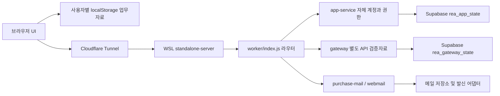
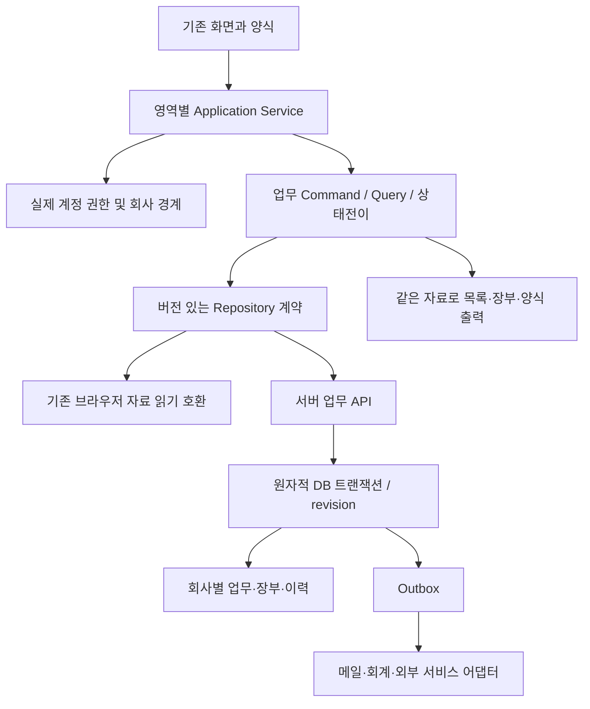
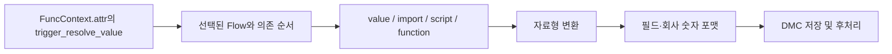

# REA ERP 매뉴얼 동등성 아키텍처

## PDF 다운로드 경계와 납기일의 독립 저장 범위

현재 인쇄와 별도인 원본 PDF 진입은 전표별 양식/재료·전체페이지 offscreen 준비 뒤 공통PDF 액션에 권한/용지/방향/여백·customization을 넘긴다. 본체 print$DownloadPdfProgram의 실제파일/파일명/오류 계약 없이 현재 PO-mail PDF 또는 browser print 경로로 대체하지 않는다. 공개 원본은 inert분석만 수행했다.

납기일 FAQ2본문에 대해 기존 core가 만료일자 저장·원요청/자식계획의 독립수정·백업재조회 범위를 충족함을 신규Node2로 확인했다(root/실제0.87). schema/계산/동기화/업무권한·앱을 변경하지 않았다. 실 UI 저장/조회권한/운영 합격은 별도다. `evidence/manual-request-pdf-contract-20261023.json`.

## 현재 운영 · 0.87.0 기본 발주요청서 상단 정보와 행 거래처

공식 EC-VID-13914의1080p 관찰206초에서 기본 발주요청서의 전표번호/입고될창고/담당자/납기일자/프로젝트/참조와 행 거래처명을 확인했다. 기본 요청서 인쇄에 해당6개 상단 항목과 거래처명 열을 추가했다. 기존 사용자/조건부 양식은 기존 상단·열 배치/용지/꼬리말을 유지하며 명시된 supplier 열의 표시/숨김·명칭·폭/정렬이 우선한다. 거래처는 저장된 행 supplier만 사용하고 공란/누락을 현재 품목/상단 거래처로 다시 채우지 않는다. 사용자 추가값이 이를 덮지 못하며 미등록 행 거래처/창고의 기존 백업 거부도 유지한다.

모바일 상단은 한 쌍씩 쌓고 표만 내부 가로스크롤한다. 단건 요청서 인쇄의 계정/회사/조회권한·설정·저장raw/원본 전표/route·DOM을 검사하고 메뉴 이동 때 창을 닫는다. 기존 인쇄 양식의 명시 저장/적용은 계속 동작한다. 신규Node8(root/분리)·초기 관련26·신규브라우저2·최종verify:local exit0(전체npm test/브라우저125·도구7/릴리스4/환경/분리빌드) 통과다.390/1280px 화면과 실제 Chromium PDF2쪽의A4세로/A5가로를 확인했다. 자체 REA6.4 새7범위 파싱실패0·coverage unknown/truncatedfalse, 기존 원본2범위는 입력/설정/결과/근거 해시를 재검증해 재사용했다. 새 원본분석/다운로드/본문0이며 영상 전체완독/원본 서버·실제Android/프린터 합격은 아니다.

source `ad08cfa`·release `3960e78` push 후0.86 기반 분리0.87을 기존 WSL·Supabase·Cloudflare에 반영했다. 공개버전/정적파일해시·익명메일401/공개health404·내부health200/Supabase를 확인했다. 기존로그인 유지·운영 요청서1건의 상단6항목/거래처명 열을 실제인쇄/저장 없이 확인하고 닫았다. 해당 요청서의 과거 공란은 유지한다. 운영 다건 자료가 없어 여러건/기존 조건부 저장양식과 실제프린터·Android 합격은 합성결과와 구분한다.

새 브라우저백업10/23 (10)→(11)은8전표/요청1/계획0·전체JSON/양식 byte동일이다. fresh서버app30/gateway0 본문/수정번호·runtime.env·메일3함8통1첨부 exact동일, 복원미리보기0충돌/appliedfalse다. bundleSHA `37f26c42722639590d52c6f340f317e3ecc244c7ca055d87708e36cab33467ab`·runtime60635/PID2508011이다. root 전체빌드/미배포VAT5·mapping 포함0이다. 초기 합성 fixture의 사용중단거래처 생성·미등록참조/자동활성양식·배경selector 가정을 정정했고, 검사로 단건 메뉴이동 callback 경로를 발견/차단했다. 자체검토를 수행했으며 독립 에이전트 검토는 없다. 근거 `evidence/manual-request-print-fields-20261023.json`.

목록54/본문24/요구사항30/전체최종합격0 유지다. 모아 필수 업무문서 read/update 도구가 없어 마지막실제저장/재조회0.51.0·81갱신 로컬대기이며 게시완료가 아니다. 다음은 **요청서 인쇄창의 PDF 버튼 출력형식/파일명·액션 전달계약**을 대조한다. currency/BODY/업로드/TC101P_01의 기존 근거 gate를 유지하며 mapping 후보는0.87 위 재통합이 필요하다. 변화 없는 같은 helper/회귀를 반복하지 않는다. 전체매뉴얼완료false.

## 발주요청 인쇄의 기본/사용자 양식 보존

printSchema는 type/record별 유효 print양식의 기본/사용자 여부만 읽어 신규 거래처 열의 기본 표시를 정한다. appendPrintDocument의 요청서 분기는 기본 양식에서만6개 상단 값을 DOM text로 출력한다. 거래처명은 기록된 line.supplier를 등록명/원문 코드로 해석하며 품목 기본값을 적용하지 않는다. 단건과 배치는 같은 함수를 쓰고 사용자 양식 metadata 자체는 쓰지 않는다. 새 page 옵션·공통 양식 스키마 변경은 없다.

## 0.86.0 적용 결과와 다음 순서

발주요청 하단 인쇄의1건 제한을 풀어2건 이상 선택 시 기존 조건부 양식으로 전표별 미리보기/명시인쇄한다. 공통 본문 렌더를 재사용하고 계정/조회/설정/자료/선택·화면 수명을 검사한다. 실제 PDF2쪽의 A4세로/A5가로를 검증했으며 모바일 표는 내부 가로스크롤/버튼44px다. 신규Node6·최종verify:local/브라우저123·운영 단건 무인쇄 미리보기/전후전체자료·양식·서버·메일 보존을 확인했다. 운영 다건/실제 프린터·Android/전자결재 제외·PDF/메일은 미완료다. 다음은 원본 요청서의 상단/행 거래처 필드이며 기존 양식을 보존한다. 요구사항30/전체합격0·모아80갱신 로컬대기다. 상세는 PROGRESS 첫 절과 `evidence/manual-request-print-batch-20261023.json`을 따른다.

## 선택 요청서 인쇄 배치의 경계

단건 printDoc의 전표 본문 출력을 공통 렌더 함수로 추출하고 배치는 동일한 인쇄 schema/조건부 metadata를 전표별 평가한다. 배치만 독립 scoped guard와 페이지 이름을 사용하며 공유 style은 명시인쇄 동안만 설정하고 복원한다. 각 sheet에 page 이름·페이지구분을 부여하고 toolbar는 인쇄에서 숨긴다. 배치에서 저장/양식설정 commit을 제공하지 않는다. 기존 단건/반품 인쇄 경로와 양식 key는 바꾸지 않는다.

## 통화 metadata와 금액 소비자 경계

공개 subscriber의 표시/입력 format 갱신, AST input/display resolver, $exchange 우선 helper를 별도 경로로 기록했다. subscriber의 주석 _syncForeignCurrency를 실행 경로로 구현하지 않는다. 원본 code0 외화/내자 판단을 자체 KRW 코드에 그대로 적용하지 않는다. 발주요청 고유 정의와 rate writer/계산/출력 규칙을 확보하기 전에는 자체 문서의 통화 코드 선택을 금액 환산에 연결하지 않는다. 앱 변경 없이 신규 원본10범위만 분석했으며 전체 실행 동등성은 미확인이다. 근거 `evidence/manual-request-currency-consumers-20261023.json`.

## 0.85.0 적용 결과와 다음 순서

발주요청의 통화 추가를 독립 외화등록창에 연결했다. 성공 시 신규통화를 선택하고 부모는 별도 저장하며, 등록취소·부모취소·기존 양식/초안과 허용된 자체 쓰기 이외의 자료를 보존한다. 신규Node15·최종verify:local(exit0)/전체브라우저121·운영 읽기와 전후 전체JSON/서버/메일 보존을 확인했다. 실제 운영 등록/전표 저장은 미수행이다. 다음은 발주요청 고유 통화 값변경의 환율·소수점 소비자 근거이며 원화 계산을 유지한다. 미배포VAT5/mapping은 제외했고 mapping 재통합 기준은0.85다. 모아78갱신 로컬대기·목록54/본문24/요구사항29/전체합격0이다. 상세는 PROGRESS 첫 절과 `evidence/manual-request-currency-add-20261023.json`을 따른다.

## 통화 추가의 부모 수명과 자체 쓰기 경계

외화 master 입력 필드 생성/값 보존을 InventoryUI 내부의 공통 master 폼 생성기로 추출한다. configureGrid는 기본 customizer 인수를 유지하면서 별도 폼 인스턴스를 받을 수 있게 해 기존 양식 metadata를 공통 적용한다. 새 등록창은 독립 id와 지역 FormOptions 인스턴스를 사용하고 부모의 host/route/editor/customizer/activeEditorModal을 교체하지 않는다. 부모 닫기/이동 시 자식은 폐기된다. 등록창의 양식편집/설정 저장은 추가하지 않는다.

docEditor의 storageBaseline을 let으로 바꾸되 허용된 새 외화1건의 pure master command 결과를 검증하고 저장한 경로만 갱신한다. 전표/다른 master/양식/금액·재고·기존 currency prefix의 일치를 확인하며 로그/sequence만 명시적으로 허용한다. 새로운 record를 선택하고 기존 change 경로를 통해 조건부 부모 양식을 재평가한다. 등록 취소/실패 때 부모와 DB의 값은 바뀌지 않는다. 신원/권한/설정 snapshot과 부모 초안/DOM/raw를 검사하고 stale callback은 저장/선택 갱신을 할 수 없다. 이는 자체 client 상태 보존 계약이며 원본 server CAS/권한의 실행 동등성으로 주장하지 않는다.

## 0.84.0 적용 결과

외화등록의 공란 환율·소수점 metadata와 계정/회사/CAS 보존을 보완해 기존 운영에 반영했다. 신규Node8·전체npm test/도구/릴리스/빌드·최종119브라우저·운영 읽기/전후 JSON·서버·메일 보존 통과다. verify:local의 데스크톱 임의 크기 검사 실패는 test-only 정정 뒤 전체119브라우저 재실행으로 해소했으며 명령자체 exit0은 주장하지 않는다. 다음은 실제 등록완료 메시지의 소비자를 확인한 뒤 부모 초안을 보존하는 발주요청 통화 추가 연결이다. 외화금액 환산/출력·원본 취소/권한/운영 저장 합격은 미완료다. 상세는 PROGRESS 첫 절과 `evidence/manual-currency-registration-20261023.json`을 따른다.

## 외화등록 데이터 보존 설계 · 1차

saveMaster(currencies)는 저장 전의 동일 코드 record를 기준으로 비교한다. rate null은 변동환율용 미지정이며1로 대체하지 않는다. 새/변경한 고정 환율은 기존 양수 검증을 사용한다. fractionDigits는 선택적으로 저장하며 새/변경값은0~4 정수로 검증한다. 기존 누락/확장 metadata는 동일값이면 byte 의미를 보존한다. validateBackup/seed/전표 계산·잔액/환율 소비자는 변환하지 않는다.

masterEditor에 금액소수점 native select를 추가한다. 신규만2, 구자료는 미설정/기존값 보존 선택지를 사용하고 저장 시 해당 속성의 존재 여부와 원형을 유지한다. 기존 사용자 양식 readonly/hidden/명칭과 command/localStorage CAS·권한 검증은 그대로 사용한다. dropdown 추가는 부모의 DOM/미저장 값·권한/회사/CAS를 보존해야 하므로 별도2차로 다룬다. 원본 bridge의 ESA035M 신규창은 정적 근거이며 실행/서버 동등성은 미확인이다.

## 0.83.0 적용 결과

발주요청 참조의 일반 text 입력을 두 UI 지점에서 보완했다. 신규Node4·최종verify:local/브라우저117·기존로그인/읽기전용 운영확인·전후 전체JSON/서버/메일 보존을 통과했다. 원본 참조의 역할예외/서버저장 및 실제 운영업무 저장 합격은 미확인이고 전체완료false다. 후보/검증/보존 상세는 `evidence/manual-request-reference-20261023.json`과 PROGRESS 첫 절을 따른다. 미배포 mapping/VAT는 포함하지 않았다.

## 이번 구현 단위 · 발주요청 참조의 일반 텍스트 입력

공식 교육 EC-VID-13914([발주요청입력](https://www.youtube.com/watch?v=6eQxoh6CKic), 공개2024-04-03)의 1:45~1:50 실제 화면/자막에서 참조는 메모·검색 키워드 입력칸임을 확인했다. 현재 docEditor는 reference를 첨부/전표연결 미지원으로 간주해 readOnly 및 calculated로 잠그는 차이가 있다. 공개 V56↔V3 양식 item map에서도 txt_007→ref_des와 slip_link→file_cd는 별도다. 이 수정은 일반 참조 문자열에 한정하며 전표연결/첨부를 구현했다고 주장하지 않는다.

발주요청의 기본 입력 reference를 비계산 일반 text로 바꾸고 기존 getDoc→document.save→재조회·빠른검색을 사용한다. 기존 수정/빈값으로 지우기·닫기취소·저장/내용유지·저장/신규, 사용자 양식의 표시/명칭/readonly/기본값·조건 및 원문/기존 자료를 보존한다. 발주계획/발주서의 미확인 참조 계약과 회사설정·금액·재고·영속 schema는 바꾸지 않는다. 자체 readonly 권한/CAS 검증은 그대로이며 공개영상은2024설명이지 현재 계정 전체 동등성 증거가 아니다.

운영0.82.0에서 파생한 별도0.83.0 후보에 UI두 지점만 적용한다. root VAT5·미배포 mapping 후보는 포함하지 않는다. 새 합성 Node/390·1280px 셸에서 입력/저장·재조회·수정/지우기/취소/참조검색/사용자양식·조회권한을 확인한 뒤 필요한 전체회귀·REA6.4·도구/릴리스/빌드 검사와 기존 브라우저/서버/설정/메일 보존 대조를 수행한다. 원본 ERP 입력·저장/발송은 하지 않는다. 전체매뉴얼 합격은 false다.

## 이번 조사 단위 · 매핑 설정 경로의 비동등성과 실행 상태 원장

공개 OpenPopupMappingCenterUserAction→IOpenPopupMappingCenterPage_converter는 legacy TC101M과 LINK_PRG_ID/LINK_PRG_NM/FromProgramId를 사용한다(E040253은E040205로 변환). 기존 목록의 필드편집기 TC101P_01 본문은 미확보다. modern derive의 bizz_conn_sid/start_bizz_sid/end_bizz_sid 및 model/prop 기반 3종 serialization은 별도 시스템이며 optional fieldLinks schema와 자동 변환하지 않는다. modern GetDeriveMappingSettingAction 응답 공급원·서버 권한/영속화도 wrapper만으로 입증하지 않는다. 실제 legacy metadata를 확보한 뒤 adapter/설정 guard를 설계하며 현재 editor는 비활성을 유지한다.

current-release.manualParity.nextWork가 실제 인증 UI 소비자보다 뒤처진 storage 상태였으므로 current editor evidence gate로 정정하고 과거 후보에는 supersededBy를 둔다. 신규6 REA scope는 이전 입력/회귀와 별도 조사이고 coverage unknown이다. 앱·schema·운영은 변경하지 않는다. 다음 독립 조사는 EC-HELP-REQUEST-002의 실제 본문/consumer이며, 본문 접근 제한은 우회하지 않는다. 근거 `evidence/manual-mapping-editor-research-20261023.json`.

## 이번 구현 단위 · 인증 설정을 확인하는 주문 불러오기 소비자

기존 주문/전표 불러오기 버튼과 선택 적용(F8) 위치를 유지한다. 지원되는 앱 로그인 환경의 발주요청 입력만 mappingAdapter를 전달하고, 주문 행 선택 적용 시 GET /api/auth/status 한 번으로 서버의 동일 계정·회사·역할·조회/입력권한·settingsRevision/menuMappings를 확인한다. 원본/초안/활성양식과 부모 화면·브라우저 저장소가 열린 시점과 다르면 적용을 차단하며 늦은 응답·취소/부모교체·대기 중 선택/집계조건 변화·중복F8도 반영하지 않는다. 설정 변경 시 동일 계정의 최신 AuthUI 정보는 갱신하되 현재 선택/초안은 보존하고 다시 열어 확인한다.

EntryUI application은 기존 동기 경로를 그대로 지원하면서 Promise 결과가 있는 경우에만 대기하고 바쁜 상태를 표시한다. 동기 onApply는 실제 전표 저장을 하지 않는 기존 초안 반영 경로다. 선택된 주문이 없는 흐름/지원되지 않는 로컬 미리보기는 기존 결과를 유지한다. 실패는 기존 오류 영역에 표시하고 통신 재시도는 사용자의 다음 적용 동작으로만 진행한다. 신규 원본 필드편집 UI나 자동업무저장은 추가하지 않는다. core의 동작은 이전269검증을 근거로 재사용하고 UI/계정·권한/비동기/합성 셸의 새 증거를 추가한다. 운영 반영은 분리된0.82 기반 후보에서 필요한 전체회귀·릴리스 검사와 보존 대조를 통과한 뒤 수행한다. 원본 서버 의미/전체 매뉴얼 합격은 별도다.

### 인증 소비자 구현 결과

InventoryUI.requestMappingAdapter→EntryUI의 기존 주문/전표 불러오기→EntryCore.mappingConfig를 실제 연결했다. 지원되는 로그인 환경은 적용 시 서버 계정·회사·역할·조회/입력권한·revision/menuMappings를 확인한다. 같은 계정의 변경된 설정은 AuthUI에 갱신하되 현재 적용은 차단한다. 취소된 요청은 늦게 도착해도 AuthUI나 새 창을 갱신하지 않는다. 중복 클릭/F8은 한 요청만 만들고 오류 뒤 명시적 재시도만 허용한다. 원본/양식·초안·부모화면·선택/수량/집계·덮어쓰기 변경을 재검증하며 다른 메뉴의 기존 동기 적용을 보존한다.

실제 셸 연결 중 한 줄 text 입력칸이 줄바꿈을 제거하는 문제가 발견돼 매핑 단계에서 차단했다. LF는 multiline 장문 대상으로만 적용하며 CR/CRLF처럼 native control이 원문을 바꾸는 값은 거부한다. 원문을 정규화하거나 잘라내지 않는다. 신규 UI Node17+core1=18·관련286/286·전체 npm test·전체 Playwright119(신규4,390/1280px)·도구7/릴리스4/환경/격리빌드 통과. 브라우저는 실제 AuthUI 모듈과 localhost 합성 HTTP만 사용했고 원본/실계정 운영 합격은 아니다. REA6.4 새 자체5범위 parse0·coverage unknown/truncated false, 기존 원본4범위 해시검증 재사용이다.

원본 필드설정 편집기가 아직 비활성이고 '설정 저장→불러오기' 전체 절차는 운영에서 입증되지 않아 후보를 배포하지 않는다. 다음은 매핑설정 전용 편집기의 진입/목표필드 클릭/원본후보 metadata와 기존 저장규칙·권한·취소 계약을 기존 매뉴얼 및 **아직 분석하지 않은 해당 편집기 공개 코드**에서 좁히는 것이다. 원본 세션 복구 시 분리 설정창만 읽으며 저장/적용/주입력행을 조작하지 않는다. 로그인 없이 못 보는 계약은 미확인으로 남기고 메뉴 pair copier/이번 적용기/통과 회귀를 진척으로 재반복하지 않는다. 근거 `evidence/manual-mapping-import-ui-20261023.json`. 운영0.82 유지, 전체완료 false.

## 이번 구현 단위 · 주문→요청의 항목 catalog와 import core 후보

실제 매핑센터 menuOptions는 InventoryCore.types의 `order`/`request` 같은 전표종류 ID를 저장한다. 이전 저장 구조 시험에 쓴 route 형태 문자열은 구조 보존 사례이며 실제 적용 대상이 아니다. 이번 실행 subset은 활성 order→request 규칙의 fieldLinks version1만 지원한다. 필드편집UI·원본 미관찰 옵션은 켜지 않는다.

FormCore.effective의 조건/활성 양식에서 visible·비계산·비readonly 항목만 읽는다. source는 주문의 기본 적요(memo) 및 등록 추가항목, target은 요청의 등록 추가항목으로 제한한다. text/number/date/checkbox의 동일형식만 허용하고 source 원문을 숫자/문자/불리언으로 자동 변환하지 않는다. 대상 타입과 값은 실제 FormCore.check로 확인한다. 필드 실재/형식/보호/조건별 양식은 저장된 ID만으로 인정하지 않는다.

기존 EntryCore.stageDocuments에 optional mappingConfig 경로를 연결한다. 옵션/활성 fieldLinks가 없거나 비활성/빈연결이면 기존 결과를 그대로 유지한다. 비어 있지 않은 유효 연결은 copy·line에 한정하고 상단은 주문 한 건만 허용한다. 라인은 실제 선택 sourceLine별로 대응한다. 공란(undefined/null/빈문자열)은 skip하며 0/false는 명시값이다. 기존 nonblank와 다른 값은 overwrite하지 않고 전체 stage를 거부한다. target 양식선택이 매핑으로 변하면 재검토 오류다. 자체 안전 한도로 text20,000자·총 매핑값 JSON UTF8 1MiB를 두고 초과는 잘라내지 않는다.

본 단계는 core 후보이며 실제 import UI에서 인증 설정 snapshot을 전달하는 소비자/편집 UI와 fresh 권한·revision guard는 후속이다. 제안 목록은 별도 반환하고 전표에는 새 metadata를 주입하지 않는다. 원본/초안/양식·sourceLineId/importedFrom·수량/단가/세율/합계를 보존하는 합성 stage→document.save→재조회 및 관련 legacy 회귀를0.82 기반 격리 환경에서 검사한다. 모든 범위/정책은 자체 fail-closed subset으로 기록하며 원본 다중원본/공란우선순위/집계 예외를 입증했다고 부르지 않는다. 운영0.82 유지, 후보 미배포·전체합격 false.

### 이 단위의 구현 결과

MappingCore.catalog/stage와 EntryCore.stageDocuments의 optional mappingConfig 경로를 구현했다. 신규15·관련269/269·도구7 검사와 격리 worker build가 통과했다. 브라우저 UMD 로드 순서/SelfCore 지연 연결은 JSDOM에서만 확인했고 실제 셸/운영 버튼은 아직 설정 snapshot을 전달하지 않는다. 신규 REA6.4 자체6범위 parse0·coverage unknown/truncated false, 기존 원본4범위는 원문/입력/결과 해시를 확인해 재사용했다. 원본 새 다운로드·본문·실행·저장·배포는0이다. 숫자문자열은 stage에서 보존하며 최종 저장에서는 기존 FormCore의 숫자 정규화를 그대로 따른다.

다음은 기존 주문 불러오기 버튼의 **인증 설정 전달 어댑터**다. GET /api/auth/status의 현재 계정·회사·권한·settingsRevision/menuMappings를 확인하고 대기 중 닫기/부모교체/초안·원본·양식·설정 변경을 차단한 뒤 이 core를 호출하는 흐름을 구현·합성 셸 검증한다. 새 원본 근거가 없는 필드편집 UI는 별도로 보류하며 원본/보존/운영 합격 없이 완료 처리하지 않는다. 통과한 core/helper 분석·전체회귀를 변화 없이 다시 진척으로 세지 않는다. 근거 `evidence/manual-mapping-import-core-20261023.json`.

## 항목 연결 저장 후보 구현·합성 검증

SelfCore.validateMappingFieldLinks→validateStructuredConfig(menuMappings)→기존 config.save/권한·CAS→state/publicContext/backup 경로를 실제 합성 검사했다. helper/해당분기는 root와0.82 격리검증에서 같고 root VAT 연구는 설치하지 않았다. 미존재 metadata는 주입하지 않으며 미상형식은 read/다른section save에서 보존한다. id/context 구조검사는 향후 schema catalog/타입/보호필드 적용 검사를 대신하지 않는다. UI/전표소비자 미연결 상태로 운영 배포하지 않았다. 근거 `evidence/manual-mapping-field-storage-20261023.json`.

## 이번 구현 단위 · 항목 연결 저장 기반 (운영 미반영 후보)

매핑 필드 편집 UI/전표 적용을 켜기 전에 기존 인증 설정 저장 경로에 optional `fieldLinks`를 연결한다. 자체 저장형식은 `{version:1, entries:[{source:{context,id}, target:{context,id}}]}`이며 context는 input/lines, source/target은 같은 context만 허용한다. 기존 규칙에 속성이 없으면 반환/읽기/저장 때도 주입하지 않는다. 빈 entries는 명시적인 빈 연결이고 미상버전/null/알 수 없는 key는 해당 설정 저장을 거부하며 읽기와 다른 설정 저장은 보존한다.

목표 중복·빈/위험/경로형ID·상하단 교차는 차단하고 같은 원본을 여러 서로 다른 목표에 저장하는 것은 허용한다. ID 1~80자 ASCII 영문/숫자/밑줄·첫글자 영문/밑줄, entries100개는 자체 안전 subset이며 원본 한도로 주장하지 않는다. 필드 실재/타입/보호항목·메뉴별 적용 적격성은 후속 catalog/실행 검증 대상이다. 문자열 eval/업무 값 저장이나 자동매핑/전표계산은 하지 않는다.

수정 대상은 SelfCore의 구조 검증과 기존 `config.save` API에 대한 합성 검사다. config.write·CSRF·revision CAS·회사격리를 기존 경로로 검증하고 publicContext/backup에 저장형식이 그대로 재조회되는지 확인한다. 구형규칙/알 수 없는 저장형식/기존 전표·계정·설정/양식은 자동 이관하지 않는다. 원본 UI 대조·소비자 연결 전에는 새 설정 UI를 켜거나 저장완료를 전체매뉴얼 합격으로 세지 않는다. root VAT5는 전체빌드하지 않고0.82 기반 격리검증에서 실제 서버 소스 경로를 검사한다. 운영 배포는 후속 연결·보존 검증 전까지 보류한다.

## 현재 매핑센터 차이와 선행 설계

현재 SelfCore.menuMappings는 `{id,from,to,enabled}` pair만 검증/저장하고 SelfSettingsUI.mappingPage의 필드설정버튼은 비활성이다. 운영0.82 비서버 JS의 menuMappings 직접참조는 self-core/self-settings-ui/self-ui뿐이며 InventoryUI/EntryCore에 적용 소비자가 없다. 새로운 `fieldLinks`를 기존 strict schema에 임의 추가하면 저장에서 거부되므로 설정 검증→인증 서버 설정/CAS/publicContext→import draft 소비자를 함께 설계해야 한다.

이전 규칙은 새 metadata를 읽기로 주입하거나 기본 매핑으로 변환하지 않는다. versioned optional 항목매핑·허용메뉴/필드/타입 및 미상형식 보존, 저장 취소/충돌·비활성·기존라인 lineage/재고/합계 소비자 계약이 선행이다. 구매 우선으로 기존 주문→요청 import의 별도 제안 단계를 사용하고 알 수 없는 필드/타입·상하단 결합·업무 계산 덮어쓰기는 차단하도록 설계한다. 실제 원본 필드선택 UI·빈값/다중원본 우선순위는 관찰 전 미지원이며 이번에 앱 schema/버튼을 변경하지 않았다.

upload 분기 정정: GetAttributeSettingProgram은 설정편집용 서버 metadata 변환이다. 웹자료올리기의 행상태/유효행·input_required_value/internal-import-target 분기와 별개로 추적한다. 일반입력 valid_key_list 분기를 upload 필수조건으로 재사용하지 않는다. 근거 `evidence/manual-upload-policy-supplier-20261023.json`.

## BODY 묶음·입력순서 조사 (운영0.82.0 유지)

원본 common.util.definitionUtil의 props_layout.target_props.items→양방향 bundle map→정의별 ApplyWidget 순회와 grid의 association_prop/section_type 설정 공급을 확인했다. 자체 request BODY의 평면 schema/native select/표시span·tbody 교체/잠금과 원본 bundle을 자동동일시하지 않는다. 설정편집 펼침순서와 적용 items순서는 별도다. 원본별 mapper/키보드소비자 계약을 먼저 확보하며 상단 DOM/CSSGrid 또는 전역 양의tabindex로 table focus를 덮지 않는다. 운영/자료schema는 그대로다. 근거 `evidence/manual-request-body-focus-20261023.json`.

## 0.82.0 발주요청 상단 입력순서

Optional focusOrder={version:1,order:positiveSafeInteger}를 추가한다. 없는/미상 metadata는 읽기/취소로 주입하지 않는다. FormOptions는 미체크 배치이동 때 이전 순서번호를 동결하고 체크저장 때 표시순서로 재배정한다. 미상metadata는 순서 조작을 차단하고 일반편집을 보존한다. request 상단 configureGrid는 DOM을 inputSequence로 두고 CSSGrid order로 표시를 유지한다. 다른메뉴/BODY와 전표 값/계산/영속은 변경하지 않는다. 근거 evidence/manual-request-input-order-20261022.json

## 0.81.0 발주요청 기본 추가항목

FormCore.fieldCatalog는 doc:request/input·lines에만 기본 슬롯을 반환하고 optional catalogSlot/multiline metadata를 저장한다. 기존 legacy 필드에 metadata를 주입하지 않는다. FormOptions 선택기에서 중복슬롯을 제외하고 타입을 고정한다. InventoryUI의 장문은 text 저장값/줄바꿈을 textarea로 표현한다. 조회/인쇄의 base 투영은 custom:false가 되므로 명시된 input/lines 외 context에서 이를 허용하면서 슬롯ID/type/장문을 검증한다. 기존 compute/check·영속/custom 값·백업과 계산은 유지한다. 근거 evidence/manual-request-field-catalog-20261022.json

## 현재 보완 · 0.80.0 BODY 필수 표시와 오류 안내

InventoryCore.applyForm→FormCore.compute/check의 기존 중앙검증은 유지하고 saveDoc의 line 호출에 유효품목 순서/코드 오류 문맥만 추가했다. 화면은 lineMeta.required를 열 별표/aria-required로 표시한다. commit의 lastCommitError를 편집창 role=alert에 보존하고 저장 시 초기화한다. UI 검증기는 중복 추가하지 않았다. 화면 공란행 제거 후 순번임을 명시하며 영속자료·계산·설정 schema는 그대로다. 다음 추가항목 한도는 metadata/메뉴 예외를 실제로 확인한 후 신규추가UI에 연결하고 legacy 양식은 변환하지 않는다. 운영0.80.0·목록54/본문24/요구사항27/전체합격0. 근거 evidence/manual-entry-required-guidance-20261022.json.

## 현재 업로드 계층 · 운영0.79.0 / 회사 저장규칙과 검토 snapshot 연결

SelfCore.requestUploadRules(version1/null) → 기존 app config.write/수정번호 CAS → publicContext.settingsRevision/settings → RequestUploadInputCore.saveRulesSnapshot → RequestUploadSaveRules.inspect → Preview의 raw/proposed/typed-none/unknown → 실제 ReviewUI로 연결한다. 브라우저 표시설정/양식값과 업로드 숫자 input version2 정책은 계속 분리한다. legacy load는 null을 메모리에서만 보충하고 DB/수정번호를 쓰지 않는다. 서버·스키마·계정·자료 이관은 없다.

서버 /api/auth/status를 검토 전·focus/storage에 읽어 identity/read permission/settingsRevision/settings를 비교한다. 중복 요청을 병합하고 확인 중 조작을 막으며 실패/변경은 raw/review를 폐기한다. 종료/호스트교체/권한변경 뒤 비동기 결과를 적용하지 않는다. 금일과 source timezone/asOfDate/일변경 guard는 Asia/Seoul 한 기준이다. none은 제안 metadata로 유지하고 KRW/빈 문자열 저장인코딩을 만들지 않는다. 최신전표 공급원·묶음 순서/Validator/영속 소비자는 unresolved이므로 전표저장 계층은 연결하지 않는다. 이 회사설정 화면은 검토용 subset이며 원본 공통 initializer/업무설정 엔진 전체가 아니다. 합격/제한 evidence/manual-request-upload-save-policy-20261022.json.

## 이전 업로드 계층 · 운영0.78.0 / 저장시규칙 통합 전

현재 입력정밀도는 RequestUploadPolicyCore version2이며 Renderer.value_format과 구매 표시 자릿수는 공급원에서 제외한다. 아래 version1 설명은 과거 독립 후보 이력이다. 0.78.0의 실제 snapshot/Review는 등록참조와 독립수량/금액/환율 검토만 제공하며 전표저장은 없다.

새로 관찰한 저장시값변경은 `initializer` 자체나 무조건적인 공란 기본값과 다르다. 요청 업무설정의 기본 기존값유지와 업로드/엑셀/OAPI+공란 예외를 각각 표현해야 한다. 일자/거래유형은 초기값 참조이고 외화종류는 직접입력없음이다. 거래유형 초기값의 최신전표 공급원·없음의 저장표현·그룹화 전후순서는 아직 확정하지 않았다. `-` 목록요약은 예외규칙 부재를 뜻하지 않았다.

다음 versioned save-rule snapshot은 회사·설정revision/field/source를 고정하고 raw/proposed/none/unknown 및 초기값 결과출처를 분리한다. 외부 original 설정을 가져와 저장하거나 원본 Flow를 실행하지 않는다. 기존 account/company/config/raw/route guard에 연결하고 지원하지 않는 식/누락공급원은 unresolved로 유지한다. 이 snapshot을 실제 Preview/InputUI에 연결하기 전 미연결 helper만으로 배포하지 않는다. 일반문서의 qty×price 계산·VAT5·모든 유효금액 소비자와 업로드 수동금액 영속화는 별도 저장계약이며 변경하지 않았다. 구체적 순서/검사는 docs/plan-request-upload-close-20261022.md, 근거 evidence/manual-request-upload-save-rules-20261022.json이다.

## 과거 version1 후보 · 업로드 정책 metadata의 양식·구매·공통 계층

독립 RequestUploadPolicyCore는 명시 version1 snapshot의 양식 explicit/default/unknown을 구분한다. explicit0도 유효하고 default는 구매값만 선택한다. 미상양식이나 미상구매를 공통 수량·단가로 대체하지 않는다. 금액은 공통0~2, 수량/단가는0~6이며 공통 표시/반올림과 분리한다. quantityUse는0자리와 별개의 boolean/null이다. provenance/unresolved를 보존하고 확인된 경우에만 기존 review 검사에 호환되는 quantity/amounts를 만든다. 외화/필수/묶음/저장 계약은 계속 미해결이다. 원본 popup의 실제 formatter 호출/서버 schema를 복제한 것은 아니며 회사/양식 설정·adapter는 미연결이다. 기존 FormCore/FormOptions는 자릿수 metadata가 없으므로 다음 nullable schema/UI/guard를 별도 설계한다. 근거 evidence/manual-request-upload-policy-20261022.json.

## 0.74.0 읽기 전용 업로드 메뉴 연결

RequestUploadInputCore는 Excel TSV의 문자열/빈셀/인용탭·CRLF/따옴표를 보존하고 자체1MiB/1000행 자원한도를 검사한다. registered snapshot은 기초자료 코드·명칭·바코드·사용중단만 복사하며 수량·금액·통화 정밀도/필수는 null이다. Preview는 미상 정책에 영점/표시정밀도를 대입하지 않고 원문과 검토사유를 반환한다. InventoryUI launcher가 계정·회사·조회권한/설정JSON·raw/route/host guard를 구성하고 InputUI가 storage/focus/조작·닫기/메뉴이동 때 폐기한다. 서버 권한 실변경 동등성은 미검증이고 저장 API/브라우저 초안은 만들지 않는다. 기존 general entry paste·InventoryCore 자동계산·DB schema는 유지한다. 저장 선행 versioned uploadSnapshot/CAS·기본/추가수량/유효금액 소비자 차이표는 docs/plan-request-upload-close-20261022.md에 추가했다. 운영0.74.0은 검토까지만 제공하며 전체업로드 완료가 아니다. 근거 evidence/manual-request-upload-connection-20261022.json.

## 업로드 검토 컴포넌트 수명과 화면 범위

RequestUploadReviewUI.mount는 모델을 JSON snapshot으로 분리하고 textContent만으로 원문/제안값·수량·수동금액을 표시한다. WeakMap host 소유권·AbortController listener 정리·필수 isCurrent callback으로 false/예외·교체/닫기/remount 후 오래된 조작을 차단한다. 실제 계정/자료 revision 변경 통지는 아직 caller adapter 연결 전이다.50행 페이지는 자체 DOM 자원정책이며 원본300건 제한과 무관하다. Scoped CSS는 toolbar button36/44px·checkbox16px를 고정하고 표에만 가로스크롤을 둔다. 신규Node9/관련54와 고립 HTML 브라우저2검사는 실제 앱셸/운영 권한 합격이 아니다. 입력붙여넣기·파일해석·메뉴/DB/저장은 미연결이며 일반입력 자동계산/영속자료는 바꾸지 않는다. 근거 evidence/manual-request-upload-review-ui-20261022.json.

원본 ICRMSetupPage/위젯설정/묶음기준의 읽기 전용 관찰과 새 공개V56 CRMSetupPage 범위 분석은 보고서 template_widget 구성을 확인한 것이다. 입력 기본값/필수/그룹 equality와 저장순서는 미확인이다. 다음 연결은 실제 회사/기초자료 snapshot·revision guard와 업로드 전용 수량/명시금액 versioned schema/CAS·소비자 보존 계획을 먼저 확정한다.

## 업로드 행별 검토 모델과 기초자료 snapshot

RequestUploadPreview는 raw/수량/명시금액 검사 위에 등록 items/partners/currencies의 정확 일치 후보를 연결한다. 코드/바코드/명칭 우선순위는 미확인이라 상충·중복·중단은 검토로 남기는 자체 정책이다. Map 인덱스로 prototype형 코드를 구분하고 중복후보20개/잘림표시로 반환량을 제한한다. 등록통화별 자릿수·품목별비율만 적용하고 원문과 제안값을 분리한다. 필수 null과[]·빈행과오류를 구분하며 그룹/기본값/권한/저장/재시도는 미해결 metadata로 남긴다. 항상saveSupported=false이며 clear상태는 일부검사 사유없음을 뜻한다. actualUI/DB/영속스키마 연결은 별도이며 기존 입력·자료·양식은 변경하지 않는다. 근거 evidence/manual-request-upload-preview-20261022.json.

## 업로드 명시금액과 일반 입력 계산 분리

inspectAmounts는 단가/외화공급가액/공급가액/부가세를 독립 십진 문자열로 보존한다. 공란0은blank-zero 출처와 원문공란을 남기고, 명시0과 구분한다. 회사 국내금액/단가·통화 금액 소수 자릿수 snapshot을 받아 범위를 검사하며 미상·형식 오류는null과 사유를 반환한다. BigInt 기반 정규화이고 금액 자동계산/Number 변환/반올림/저장은 없다. 일반 InventoryCore.lineTotals의 qty×price/VAT를 업로드 저장에 재사용하면 명시값이 손실되므로 영속 스키마와 유효금액 소비자(조회·집계·백업·후속전표)를 함께 확장해야 한다. 현재 앱·DB 미연결이며 기존 계산과자료는 보존한다. 근거 evidence/manual-request-upload-amounts-20261022.json.

## 업로드 수량 관계의 정확한 분리 검사

추가수량 add_qty와 기본수량 qty를 함께 보존하고, 호출자가 명시한 업무 사용여부·기본/추가수량 자릿수·품목 비율의 snapshot으로 관계만 검사한다. 십진 문자열→BigInt 유리수→무반올림 비교이므로 부동소수 오차나 암묵1/1 기본값을 만들지 않는다. 미상비율/불일치/정밀도부족/초과를 반환하며 자동필드 선택·값교체·저장은 없다. 분자소수/분모정수·기본수량 재고관리는 공식 온라인 본문 근거다. 기존 ItemCore.additionalQuantity와 단일 InventoryCore.qty의 저장 의미를 변경하지 않는다. 전체업로드 연결 전 수동금액 보존·회사별 metadata·양쪽 입력 우선순위 계약이 필요하다. 근거 evidence/manual-request-quantity-20261022.json.

## 업로드 입력 해석 분리후보 · 운영 미연결

원본 UI/빈서식22열의 표시명과 field ID를 고정한 RequestUploadCandidate.stageRaw를 독립시켰다. raw 셀과 String.trim 결과·원본행번호를 반환하며, 명시한 제목행/자원행수 정책으로 누락/초과열을 검사한다. inv_m$add_qty와inv_m$qty를 별도로 보존하고 금액/코드/일자를 해석하지 않는다. 원본 _.vTrim의 모든 Unicode 동등성은 미확인이다. 현재 회사의 관찰 schema snapshot이며 전체회사 설정으로 간주하지 않는다. UI/DB/권한/저장 스키마에 연결하지 않았다. 이후 회사별 metadata→단위환산/금액보존→묶음/기본/필수 검증→미리보기→동시성/권한/저장 계층을 각각 합격시킨다. 일반 입력의 자동계산을 업로드 수동금액에 바로 연결하지 않는다. 근거 evidence/manual-request-upload-candidate-20261022.json.

## 0.73.0 생성 전표 참조 일괄지정

PurchasePlanCore.preview는 선택적 request.referenceOverride를 공백 아닌 텍스트로 검증하고 기존 그룹 계산 후 생성 doc.reference만 지정한다. 문자열 자체를 변환하지 않으며 기본 생략은 기존 생성 결과를 보존한다. 원본 참조 상속·빈값 삭제는 미확인으로 지원하지 않는다. UI input 이벤트는 prepared를 즉시 무효화하고 전표별 context에 textContent로 표시한다. commit의 재미리보기/snapshot 및 기존 권한/storage guard를 보존한다. 새 스키마·그룹·금액·배분·원본 자료 변경은 없다. 입고창고는 현재 배분/백업 guard와 충돌하므로 원본 예외 계약 확보 전 변경하지 않는다. 근거 evidence/manual-plan-generation-reference-20261022.json.

## 0.72.0 생성 후 머리 담당자 일괄지정

PurchasePlanCore.preview는 기존 그룹·행·배분을 먼저 구성하고, 선택된 경우에만 생성 전표의 employee를 덮어쓴다. request.employeeOverride는 활성 등록코드여야 하며 기본 생략은 계획별 값을 보존한다. prepared request/snapshot과 commit 재검증으로 선택·원본·기초자료·권한 변경을 검사한다. UI 선택 변경은 prepared를 무효화하고 미리보기를 다시 요구한다. 원본 계획·계산·그룹·스키마·자료 변환은 없다. 담당자 지정으로 상이 머리값을 강제 병합하지 않는다. 다른 일괄필드의 계산/배분 계약은 별도 미완료다. 근거 evidence/manual-plan-generation-employee-20261022.json.

## 0.71.0 생성 미리보기의 조건·금액 표시

PurchasePlanCore의 prepared.documents를 변경하지 않고 별도 fragment에 요약표·전표별 context를 준비한 뒤 성공 때만 미리보기 DOM을 교체한다. 담당자/프로젝트/창고/통화/세율/반올림/추가항목/원본계획을 textContent로 표시한다. 수량은일반숫자,금액·단가는formatNumber money:true를 사용한다. 표시실패 시 prepared를 폐기해 이전 화면으로 생성하지 못한다. 기존preview snapshot·commit/권한/storage guard는 그대로다. CSS는purchase-plan-dialog 한정36/44px와context grid이며 input/report 전역selector확대없음. 직접집계추가축·일괄변경 및 미선택 머리값 매핑은미구현, 새schema/자료변환없음. 근거 evidence/manual-plan-generation-review-20261022.json.

## 0.70.0 발주계획 날짜조회·원자적 렌더 보완

계획목록5개날짜단축키는 PurchasingReportCore.preset을 명시적일요일주(weekStart0)로재사용한다. applySearch는날짜외pending조건을보존하고 refresh가 rows/tabs/table/pager/count/권한을모두offscreen준비한후DOM과조건을같이반영한다. 실패시applied/page를복구하고기존DOM/미저장행/선택/pending날짜를유지한다. 조회구분의 서버대표수량/합계·선택단위는별도미완료이며 새스키마/권한확대없음. 근거 evidence/manual-plan-search-modes-20261022.json.

## 0.69.1 UI/UX 적용 보완

column entry toolbar는 nowrap로 내부 grid의 intrinsic높이 팽창을 막는다. 요청목록 fallback과 보고서 검색행을 각각 inv-request-list/inv-report-head로 한정한다. 보고서 모드·검색작업행은 독립class, radio18px/label44px 및 필터44px로 제어하며 print·hidden 규칙과 기존query/snapshot핸들러를 보존한다. 실제 index/app shell의5입력/4현황×7폭높이=63조합/브라우저78을검사했다. 운영0.69.1·자료/양식/계정/메일보존확인, 실제Android재시험은미완료. 근거 evidence/purchasing-uiux-tablet-20261022.json.

설계판 0.1 · 2026-10-21 · 작성 당시 구현 0.50.0. 아래 **현재**와 **목표**를 구분한다. 설계 작성만으로 스키마·운영 환경·자료를 변경하지 않는다.

## 1. 설계 결정

기존 JavaScript UI와 업무 코어를 유지하고 영역별로 계약을 분리한다. 프레임워크 전면 교체나 새 사이트 제작 없이 기능 차이를 순차 보완한다. 실제 구현 저장소는 /home/lck/projects/Rea_ERP, 수동 운영은 로컬 WSL 서버 + Supabase + Cloudflare Tunnel/rea.qaredi.com이다. 분석 원문은 .artifacts, 요구사항/요약 근거는 docs와 evidence, 실행물은 dist에 분리한다.

## 2. 현재 구조 — 코드 확인

| 현재 책임 | 파일/계약 | 확인한 제약 |
|---|---|---|
| 화면·작업탭·메뉴 | dist/app.js, menu-core.js, inventory-ui.js | 화면별 전용/공통/메뉴만 존재를 구분해야 함 |
| 업무 규칙 | inventory-core.js, entry-core.js, purchase-plan-core.js, purchase-room-core.js | 기존 순수 명령/검증 및 합성자료 검사 재사용 |
| 필드/출력 양식 | form-core.js, form-options.js, entry-ui.js | 기존 필드ID·사용자 설정 유지 필요 |
| 사용자 업무자료 | inventory-ui.js load/commit | 사용자별 localStorage, 전체 JSON 저장. 공용 서버 장부 아님 |
| 인증/정책 | worker/app-service.cjs, dist/self-core.js | 자체 세션 쿠키·CSRF·역할/계정 검증. Supabase Auth로 바꾸지 않음 |
| 서버 상태 | worker/supabase-db.cjs | app/main과 gateway/sandbox 두 행, revision 조건부 PATCH. 범용 SQL API 아님 |
| 메일 | worker/webmail.cjs, purchase-mail.cjs, scripts/mail-rest-store.mjs | 기존 메일 ID/첨부/수신 규칙 보존 |
| 실행/배포 | scripts/standalone-server.cjs, build-worker.cjs | 서버 번들/정적 파일·수동 실행·버전별 검증 |

브라우저 업무자료와 gateway 검증자료는 같은 저장소가 아니다. 현재 계정·메일 운영 성공이 모든 ERP 업무의 공용 저장·동시성·권한 동등성을 입증하지 않는다.

## 3. 목표 구조 — 점진 적용

초기에는 기존 local adapter가 기본이다. 새 서버 저장은 모듈별 전환 지점이 있으며 모든 브라우저 자료를 자동 업로드하거나 빈 서버 상태로 바꾸지 않는다. 공용 업무를 필요로 하는 기능은 실제 서버 adapter와 두 사용자 검증을 통과해야 완료다.

## 4. 영역 경계와 의존성

공통 계정/회사/권한·기초자료·양식 → 구매/재고/영업 → 생산/원가 및 회계 → 세무/급여 → 결재/포털/외부연동 순으로 연결한다. 결재·감사·메일 등의 공통 서비스는 필요한 단계부터 적용한다. 뒤 단계에 필요한 최소 회계/권한 계약은 앞 단계에서 먼저 정의한다.

각 영역은 Command(검증/쓰기), Query(조회), Policy(기본값/기간/권한), Projection(장부/집계), Adapter(저장/외부), View(표시)를 구분한다. 현재 큰 inventory-ui.js에서 기능을 추출할 때 기존 동작 검사를 유지하며 관련 범위만 분리한다. 정책의 우선순위·빈 값·중단 코드 처리는 매뉴얼 근거가 있을 때 확정한다.

## 5. 목표 데이터 계약

다음은 논리 모델이며 아직 운영 테이블을 생성한 것이 아니다.

- Company / User / Role / Permission: 기존 ID·인증 방식 보존, 회사/사업장/창고/역할 범위.
- MasterRecord: 품목·거래처·창고·프로젝트·관리항목·통화·세율 등, 코드/사용상태/유효 시점.
- BusinessDocument / Line: 안정적 문서·행ID, 업무일·작성/수정시각·버전, 원본 연결, 수량/단가/금액, 설정 snapshot.
- DocumentLink / Allocation: 원전표와 결과전표의 행별 소비량·잔량. 복수 원전표/부분 처리에서도 중복 소비를 막음.
- InventoryMovement / LedgerEntry: 입출고/이동/반품 및 회계 영향의 근거, 취소는 매뉴얼의 상태/역처리 계약에 따라 추적.
- FormDefinition: 기존 ID와 필드순서·숨김·필수·기본값·출력 레이아웃·개인/공용 범위·버전.
- ApprovalInstance / Step / Decision: 사용자 신원, 전표 revision, 순차/병렬 규칙, 반려/회수/재상신. 로컬 상태문자만으로 승인 완료 처리 금지.
- Outbox / ExternalResult: 작업 ID, 전표 revision, 재시도 횟수·상태·외부 결과 ID. 타임아웃을 성공으로 만들지 않음.
- AuditEvent / MigrationManifest: 행위자·업무 객체·버전·동작·변환 근거, 비밀값/개인정보 최소화.

금액은 목표 서버 모델에서 정확한 decimal 또는 통화별 최소 단위 정수를 사용한다. 수량 소수 정밀도·세액/공급가 반올림은 문서 정책으로 확정하며 현재 자료를 일괄 재계산하지 않는다. 업무일과 시각(UTC 저장/사용자 표시)을 구분한다.

## 6. 쓰기와 동시성

명령 계약 예: `{commandId, documentId, expectedRevision, payload}`. 회사·사용자·권한은 신뢰된 서버 세션에서 정하며 브라우저 요청값만 믿지 않는다. 변경 전 조회 권한과 변경 권한, 대상 회사, 마감, 원전표 잔량을 서버에서 확인한다.

전표·행별 배분·재고/장부·감사·outbox는 동일 DB 트랜잭션 안에서 확정한다. 기존 REST 두 행의 CAS를 여러 테이블의 트랜잭션이라고 주장하지 않는다. 새 저장소는 검증된 서버 전용 PostgreSQL 호출/RPC 등 원자적 수단을 구현·시험한 뒤 사용한다. 현재 Supabase adapter에 임의 SQL 문자열을 확장하지 않는다.

동일 commandId 재호출은 동일 결과를 반환하고 중복 입고·이동·결재·발송을 막는다. revision 불일치는 409 및 재조회/차이 확인으로 처리한다. 사용자 수정 중 조회/양식 변경이 초안을 날리지 않아야 한다. 취소·재시도·오류 복구는 요구사항별 상태전이 표로 정의한다.

## 7. 기존 자료 전환

1. 현재 로그인 상태와 브라우저 자료, 서버 상태, 양식, 메일, 설정의 비공개 백업·해시·개수·합계·참조를 확보한다.
2. 원본을 쓰지 않는 변환 미리보기로 누락/중복/회사/참조/기간/금액 충돌을 보여준다.
3. 기존 키·ID·양식ID를 보존하거나 매핑표로 추적하며, 시각/세율을 과거 자료에 지어 넣지 않는다.
4. 새 저장 영역에 멱등 import를 수행하고 원본 백업을 그대로 남긴다. 계정이나 서로 다른 사용자의 자료를 무조건 합치지 않는다.
5. 조회 결과·금액·잔량·양식·메일을 비교하고 두 사용자 권한을 검증한다.
6. 기능별 저장 대상을 전환하며 되돌릴 버전·백업·쓰기 중단 지점을 정한다. 실패 시 기존 자료를 자동 삭제하거나 덮어쓰지 않는다.

실제 전환은 릴리스 절차와 해당 사용자 작업 권한 범위 안에서 수행한다. 이 설계판은 전환을 실행하지 않는다.

## 8. 인증·Supabase·외부 연결

자체 계정 세션을 유지한다. secret/service-role 키는 서버의 비공개 설정만 사용하며 브라우저 번들·커뮤니티·로그에 포함하지 않는다. 서버 권한검증이 필수이며 RLS는 추가 방어다. exposed schema의 명시 grant와 RLS를 함께 검토한다. 자체 앱 사용자ID가 자동으로 Supabase auth.uid()가 된다고 가정하지 않는다.

API키·쿠키 인증의 경로별 권한, CSRF/Origin, 입력 크기·첨부 경로·조회 범위를 회귀 검사한다. 권한 변경 후 오래된 세션/전표/발송 요청도 다시 확인한다. 외부 발송/신고/결제는 준비·제출·실제 성공·실패를 구분한다. 외부 시험에는 업무자료 없는 지정 시험을 쓰고 실제 발송 등의 별도 승인이 필요한 시점에 구체적인 대상과 내용을 정한다.

공식 [Data API 보안](https://supabase.com/docs/guides/api/securing-your-api)과 [변경 내역](https://supabase.com/changelog)을 확인했다. 2026-11-10 예정 구형 TLS 암호군 종료가 공지되어 있으므로 이후 배포 연결 검사에 포함한다. 이번 작업은 인증/DB/DNS를 변경하지 않았다.

## 9. REA 원본 구조 분석

REA CLI는 프로젝트에 고정된 6.4.0을 쓴다. 매뉴얼 기능 → 화면/프로그램ID → 공개 자산 URL → SHA-256 → AST 범위/심볼 → 의미 그래프 노드/관계 → 자체 코드 대응 → 테스트를 연결한다. 원본 번들을 실행하지 않는다.

원본과 자체 코드는 입력 디렉터리/manifest를 분리한다. 캐시 키는 입력·설정·도구 버전·결과 해시를 포함하고 evidence schema·실제 파싱 수·실패 수·semantic coverage의 truncated/누락을 확인한다. 큰 번들에서 생략이 있으면 해당 기능의 경계가 보존된 작은 범위로 재분석하고 외부 미해결 관계를 명시한다. 파싱 성공과 runtime dispatch/서버 규칙 확정을 구분한다.

현재 원본은 과거 0.50의 거래유형·관리항목 4개 범위/팝업 wrapper 자료를 근거로 연결한다. 최신 원본 본문 해시의 실보유 여부를 다시 확인하고 누계86개를 곧바로 현재 확보 수로 쓰지 않는다. 오래된 11개 원본 경로를 검사하는 rea:sources 결과는 모두 missing이며 전체 현재 corpus 검사와 다르다.

이번 자체 서버3파일(app-service, gateway, index)은 REA 구문분석3/실패0, 노드7873을 확인했다. 의미 그래프는 truncated=false지만 coverage=unknown, 외부/동적 의미에 partial 관계가 있어 전체 의미 완전성이나 원본 동등성으로 기록하지 않는다.

## 10. 검증과 배포

각 요구사항에 문서/관찰 근거, 순수 코어 검사, 저장·동시성·권한 통합 검사, localhost 합성 브라우저 흐름, 실제 운영 인증/자료보존 검사, 외부/장비 증거를 연결한다. 기존 검사를 버전이 다른 새 요구사항의 합격으로 자동 승격하지 않는다.

배포는 요구사항별 작은 릴리스로 진행한다. 관련 검사 → 전체 verify:local 및 release 검사 → 버전/커밋 → 원격 push → 비공개 백업 → 지정 서버만 수동 반영 → 공개 HTTPS/자산/인증 → 로그인 후 업무 검증 → 자료/양식/메일 보존 → 모아 기록 순서다. 실패 시 성공 기록을 남기지 않는다. 문서만 변경하는 이번 판은 운영 재시작과 앱 버전 증가가 필요 없다.

## 11. 결정 대장

- ADR-01 채택: 기존 앱의 점진 확장, 현재 배포 환경 유지.
- ADR-02 채택: 매뉴얼 시나리오가 완료 단위, 메뉴/REA 후보 수로 완료율 산정 금지.
- ADR-03 채택: local/API/공용 서버 자료의 계약 분리와 보존형 전환.
- ADR-04 설계: 원자적 전표/배분/장부·멱등 outbox, 구현·테스트 후 적용.
- ADR-05 채택: 자체 계정 유지, 실제 사용자 결재는 별도 구현.
- ADR-06 채택: 원본 정적 분석·직접 관찰·자체 정책을 근거로 분리.
- ADR-07 채택: 커뮤니티는 설계/진척의 읽기 가능한 기록, 코드/상태의 근거는 Git과 evidence로 추적.

관련: [PRD](PRD.md), [진행 순서](ROADMAP.md), [조사대장](manual-inventory.md).

## 12. 거래별 부가세 금액 계약 · 2026-10-21 추가

REQ-COM-TAX-001의 첫 단계는 `transaction-vat-core.preview/verify` 순수 계산이다. 입력을 바꾸지 않고 현 lineTotals의 행별 금액을 기준으로 동일세율/KRW 총액을 다시 분리해 마지막행의 차액을 제시한다. 기존 문서의 금액·반올림·양식 기본값은 유지한다. 일시적인 미리보기 근거 검증과 실제 저장 권한/장기 조정 메타를 구분한다.

저장 통합은 inventory-core의 저장·백업·유효금액, 전표 변환/코드변경/단가일괄변경, 반품 배분, 입력/출력/보고서 및 purchase-mail-core PDF 정규화를 한 금액 계약으로 맞춘 뒤 활성화한다. 반환·조정 메타가 있는 자료를 새 계산으로 덮어쓰지 않는다. 외화/혼합세율은 별도 요구사항 검증 전 지원으로 표시하지 않는다. 상세 계약·확인된 위험·검사 순서는 [부가세 계획](../plan-manual-transaction-vat-20261021.md)을 따른다. 이 추가 내용의 모아 게시·재조회는 로그인 복구 후 진행한다.

### 저장 금액 계약 구현 · a593c2e (운영 미반영)

`vatCalculation` 선택 필드가 없는 옛 자료는 기존 라인별 계약이다. 거래별 자료는 `vatAdjustment.version=1`에 금액 기준·원본/행 식별자·차액/합계/마지막행을 저장하고 조회/복원에서 재계산한다. 저장 요청의 `vatConfirmation`은 전체 입력 스냅샷을 대조한 후 제거한다. 기존 DB 근거와 비교하여 메타 누락이 조정 삭제가 되지 않게 하며, 새로 만든 근거만으로 확인 절차를 대신하지 않는다. 확인 데이터는 권한 토큰이 아니며 기존 권한·CAS·반품 잠금이 우선한다.

InventoryCore의 유효금액을 사용자 수식·합계·반품·구매실·메일/PDF에 연결했다. 새 전표는 조정 근거를 상속하지 않으며 코드 변경에서 원본 식별자를 보존한다. 계산 정책 선택/확인/취소/행 음영 UI와 운영 통합이 남아 있다. 서버 재시작 전 이를 완료하고 검증/버전/배포 절차를 따른다. 저장21검사·기존 브라우저30·합성 실제PDF 및 REA4파일 근거는 `evidence/manual-transaction-vat-storage-20261021.json`에 연결했다. 기존 자료/양식/메일을 이관하거나 외부 발송하지 않았다. 모아의 이 추가 본문 게시·재조회는 여전히 대기다.

### 편집기 확인 계약 구현 · 7c5a46c (운영 미반영)

TransactionVatCore.review는 표시 후보와 확인 필요 여부를 순수하게 만든다. 표시 후보를 승인된 저장 요청으로 사용하지 않는다. TransactionVatUI는 확인 직전에 권한·편집 화면·저장본과 전체 입력을 다시 대조한 후에만 vatConfirmation을 붙인다. 취소/Escape/이동은 저장하지 않는다. 기존 조정의 금액 기준이 유지되면 즉시 유효금액과 마지막행 음영을 표시하고, 입력이 달라지면 확정된 표시를 제거해 저장 전 검토를 요구한다. 빈 행을 제외한 금액행과 화면행을 매핑한다.

브라우저 저장은 dbSourceRaw를 읽은 DB와 함께 관리하고 commit/발주계획 생성에서 외부 변경을 감지한다. ‘최신 전표 다시 읽기’는 저장 JSON을 다시 검증해 해당 전표뿐 아니라 다른 자료의 외부 변경을 보존한다. 이는 localStorage 저장 직전 검증이며 동시 쓰기 전체의 원자성/서버 CAS를 보장하지 않는다. 설정 기본값 및 모드 선택은 후속 단계이고 기존 전표 자동 이관은 없다. 근거: evidence/manual-transaction-vat-ui-20261021.json. 이 추가 본문의 모아 게시·재조회는 대기다.

### 선택적 계산모드 설정 계약 · 94a569e (운영 미반영)

회사 설정의 documentVat 규칙은 네 구매 유형별 default/line/transaction을 저장한다. 원본 bizz 속성 vat_calculate_setup의 line/transaction·기본line이라는 정적 근거를 자체 스키마에 대응했으며 동적 예외조건은 포함하지 않는다. 기존 config.write/CSRF/revision CAS 경로로 저장하고 publicContext와 SelfUI 재조회에서 AuthUI에 전달한다. 옛 상태를 읽을 때 새 키를 영속화하지 않는다.

새 빈 입력을 최초 생성할 때만 모드를 스냅샷으로 적용한다. 기존 전표·보관 초안·현재 편집·임시 변환은 자동 재적용하지 않는다. 설정 선택 UI 및 계획생성/변환 적용 계약은 남았다. 원본 정적 SetVatReCalcSvc에 맞춰 실제 변경된 공급/세액 셀만 #f6d7d7·굵게 표시한다. 설정 통합24검사/VAT61/브라우저33 및 원본7·자체7 REA 근거는 evidence/manual-transaction-vat-settings-20261021.json이다. 모아 갱신·재조회와 운영 반영은 대기다.

## 계산 근거 충돌과 버전 보존 · 2026-10-21

거래별 VAT의 공식 본문은 총액을 다시 분리하고 보관 공개 번들의 계산 함수는 미반올림 공급가액 합에서 공급·세액을 각각 단수처리한다. 공통 예제는 일치하나 별도5경계값에서 충돌한다. 진단 도구와 합성 fixture는 앱 dist/worker 밖에 두며 원본 JS를 실행하지 않는다. 진단 종료0과 원본 동등성 합격은 분리되고 --require-parity는 미해결 상태에서2를 반환한다. 원본 소수 자릿수는 공급/세액 공통이므로 자체 분리된 정책과 동등하다고 추정하지 않는다.

현재 vatAdjustment.version1은 기존 총액 분리식으로 읽고 검증하는 계약이다. 새 계산식을 도입하더라도 기존 금액·백업·반품 근거를 새 식으로 재해석하거나 자동 이관하지 않는다. 신규 버전별 계산/검증/출력과 명시적 전환 계약을 먼저 확정한다. 원본의 직접 공급가액·외화·혼합세율·Decimal 호환 정밀도는 별도의 입력/정책/저장 근거가 필요하다. 근거와 후속 순서는 docs/plan-manual-transaction-vat-20261021.md 및 evidence/manual-transaction-vat-conflicts-20261021.json을 따른다.

## 연결 헤더 및 저장 계산 버전 보존 · 2026-10-21

소스6f1a017의 원본 수정 보호는 active direct sourceId 후속의 기존 유효한 거래처/창고 조건을 새로 깨뜨릴 때만 거절한다. linkedPartner/linkedWarehouse와 자식 저장의 창고 대상 목록을 공유한다. 상태 변경은 비활성→활성으로 바뀐 전표에 한해 최종 배치의 원본을 검사하므로 부모/자식 선택 순서가 결과를 바꾸지 않는다. 명령은 복사 DB에서 실행되어 실패 시 자료·이력·재고·채무를 반환하지 않는다. 기존 활성 불일치 백업을 자동 수정하거나 새 검증으로 소급 거절하지 않는다. 이는 독립 저장 무결성 보완이며 원본 수정 정책 전체와 동일하다는 의미가 아니다.

VAT v1은 고정 합성 백업과 고정 메일 결과로 금액 계약을 검증한다. 미래 식 변경 시 버전별 해석을 분리해야 하며 테스트에서 현재 계산기로 fixture를 다시 만들어 기대값을 덮어쓰지 않는다. 미지원 버전은 기존처럼 거절하고 v2/마이그레이션은 미구현이다. 근거: evidence/manual-purchase-link-preservation-20261021.json. 운영0.53.0 유지, 이 추가 본문 모아 게시·재조회 대기.

### 독립 수식 후보와 저장 버전 경계 · 4e52469

scripts/lib/transaction-vat-static-candidate.cjs는 저장v2가 아닌 연구 알고리즘 raw-supply-static-candidate-v0다. source-like 공급합과 명시적 현재 행금액을 입력으로 받아 정적 목표/차액을 산출하고 항상 canApply=false를 반환한다. 임의의 총액 보존/음수 보정/기존 금액 재생성 없이 차이를 드러낸다. UI/Worker에서 import하지 않으며 기존 vatAdjustment.version1의 읽기·수정·백업·반품·메일 해석은 그대로다.

향후 저장v2는 (1)공식 본문과 실제 적용 원본의 충돌 해소 (2)지원모드·정밀도·반올림·0/음수·직접금액 계약 확정 (3)버전별 별도 검증기·금액소비 경로 (4)명시확인과 후속반품/회계 제약 (5)옛 백업/구버전클라이언트 보존을 통과한 뒤 추가한다. candidate 결과를 version2 메타로 바꾸거나 v1식에 자동 치환하지 않는다. 현재5충돌/동등성false를 유지한다. 근거 evidence/manual-vat-static-candidate-20261021.json; 이 본문의 모아 저장/재조회 대기.

### 단가 생성과 계산 후보의 정밀도 경계 · 8c07d91

단가검색은 원본 Price/PriceVatInclude를 각각 apply_price_amt/vat_apply_price_amt로 매핑해 포맷처리한 뒤 값resolver를 호출한다. F4는 공급단가 변환 뒤 필드 포맷을 적용한다. 동적 필드 식·라이브 설정·실제Decimal이 확인되기 전 최종 공급가액 생성 전체를 재현했다고 하지 않는다. common 모듈의 R/10은 포맷 없는 apply_price_amt에 한정된 fallback이며 origin_supply_amt는 숨김열 회사포맷 fallback에서 제외된다.

연구 후보 raw-supply-static-candidate-v1은 이미 결정된 단가의10자리만 정확히 받도록 확장했다. 수량6/금액0~2/단일0·10% 범위는 유지한다. 이는 저장 vatAdjustment.version1 또는 계획된 저장v2와 관계없는 연구 알고리즘 식별자다. 앱 import·기존 금액 재계산·양식기본값 변경은 없고 canApply=false다. 근거 evidence/manual-vat-price-binding-20261021.json.

### 단계별 원본 행 식별자 계약 · 2026-10-21

sourceLineId는 언제나 현재 전표의 sourceId가 가리키는 즉시 원본의 lineId에 대응한다. 원본 자체가 상위 전표에 연결되어 있다는 이유로 그 상위 sourceLineId를 다음 단계에 전달하지 않는다. 즉시 원본에 lineId가 없으면 기존 품목별 연결/잔량을 사용한다. 기존 백업의 부모 식별자는 보존하고, 모호한 중복 품목은 기존 저장 검증으로 거절한다. 새 ID 자동 이관·양식/출처/금액 변경은 없다. 근거 evidence/manual-purchase-source-lineage-20261021.json.

### 묶음 발주 배분의 완료행 보호 · 59b2c4f

saveDoc의 generatedFrom=purchase-plan 경로는 배분 구조/출처를 검증한 뒤 (원본전표, 품목, 원본행 ID 또는 없음)별 전체 수량을 합산한다. 완료 원본행의 새 배분 합계가 해당 전표의 이전 저장 합계보다 크면 거부한다. 이전 전표의 활성 여부와 무관하게 저장 수량을 기준으로 하므로 동량 취소·복원은 보존된다. 행 진행 상태를 헤더보다 우선하는 기존 규칙과 백업 검증 정책은 변경하지 않는다. 분할·재정렬·동량 가격 수정은 허용하고 기존 자료를 이관하거나 과거 완료 기록을 소급 거절하지 않는다. 원본 ECOUNT의 완료/복원 정책 전체가 검증됐다는 의미는 아니다. 근거 evidence/manual-plan-allocation-preservation-20261021.json.

### 입력 자동변경과 숫자 후처리의 근거 경계 · 420cfd5

원본의 기본 입력 경로와 조회/인쇄 경로는 속성 출처와 extension이 다르다. 입력 경로의 정적 구조는 아래와 같다. 명시적 override와 직접 공급가액 custom sync 예외는 별도다.

현재 wrapper는 이 경로를 보여 주지만 실제 선택된 식·참조/trigger·후처리 포맷·Decimal 구현까지 입증하지 않는다. 조회/인쇄의 value_calc_expression을 입력 수식으로 대체하거나 7개 정적 기대값 일치를 전체 원본 합격으로 처리하지 않는다. 기존 저장v1·연구후보 raw-supply-static-candidate-v1은 변경하지 않는다. 근거 evidence/manual-vat-resolver-20261021.json; 모아 본문 반영·재조회 대기.

### 발주수량 보유재고 차감 연구 모델 · efca279

stock-only-integer-v0는 앱 계산/저장 계약과 분리된 scripts/lib 순수 함수다. 명시적 정수 입력·보유재고만 받아0하한 차감을 계산하며 실제 재고를 조회하지 않는다. 행 ID와 품목/창고 튜플을 각각 검증하여 같은 보유재고를 여러 계획행에서 중복 차감하는 추정 배분을 막는다. 결과는 항상 canApply=false이며 기존 전표나 양식에 저장하지 않는다. 최소구매단위·혼합조건·소수/음수·조회기준·후속발주 하한은 추가 근거 후 별도 계약으로 연결한다. 공식 사례5개의 일치는 전체 수량조정 동등성의 증거가 아니다. 근거 evidence/manual-plan-quantity-stock-candidate-20261021.json.

## 0.53.1 운영 경계 확인 · 2026-10-21

분리후보90958ac를 기존 WSL 수동 서버/Supabase/Cloudflare에 설치했다. 스키마·인증방식·기존 자료구조는 그대로다. 원본 헤더/행공급사·직접 행참조·완료계획 배분 보호를 포함하고 미완료 VAT는 main에 남긴다. 기존120분 세션이 이미 만료되어 배포 후 인증UI 합격은 재로그인 뒤 별도로 확인한다. 공개 응답·서버 자료/메일 보존과 매뉴얼 동등성은 구분한다. 상세 evidence/deployment-purchase-links-0531-20261021.json.

### Decimal 초기 정밀도와 운영 계산의 분리 · 18393fe

decimal29-divisor-order-v0는 순수 연구 함수이며 공급합/세율/단수처리만 명시 입력받는다. BigInt 유리수로100÷세율→공급합÷그값을 각29유효자리 HALF_UP하고 최종 자릿수를 처리한다. 계산 가능한 범위를 좁혀 두고 항상canApply=false/persistenceVersion=null을 반환한다. 기존 저장v1·단가 연구후보와 앱의 import/저장 연결은 변경하지 않는다. 새로운 원본 Decimal 초기 설정과 실제 실행 중 override·입력식·누적/차액배분은 별도 증거다.

현재 확인한 common 본문의 valid-key trigger는 빈행 skip 예외를 포함한다. 이전 resolver 본문과 현재 본문 해시·함수 차이를 같이 보관하고 버전 간 동등성을 추정하지 않는다. REA21범위 파싱과 독립13,302사례 일치는 실제 매뉴얼/테넌트 전표 결과의 합격이 아니다. 운영0.53.1 설치번들 보존, 상세 evidence/manual-vat-decimal-20261021.json.

### 명시적 확정세율의 그룹 배분 연구 · d8035b9

previewResolvedGroups는 각 행에 이미 결정된 numeric vatRate(검토범위0/10)를 요구한다. 실제 거래유형/품목/창고 설정을 조회하거나 추정하지 않는다. first-seen 그룹과 원래 인덱스를 보관하고 기존 단일 연구후보 결과를 원래 순서로 재배치하며 각 그룹 마지막행만 보정 대상으로 표시한다. 전역ID 유일성·전체행수·미반올림공급/현재합계/목표합계 상한을 적용해 그룹 단위 검증 우회를 막는다. 그룹별 차액이 서로 상쇄돼도 확인 필요가 유지된다.

계산/저장권한·UI 반영·부가세설정 상속은 추가하지 않았고 canApply=false/persistenceVersion=null이다. 원본의 빈행 제외/loose 세율 비교/중복ID 위치처리까지 재현했다고 주장하지 않으며 연구입력에서는 거부한다. 기존v1와 단일 후보를 보존하고 후속 증거와 저장 버전 계약 전에는 앱에 통합하지 않는다. evidence/manual-vat-groups-20261021.json.

### 발주계획 생성 선택수와 기존 전표 저장 한도의 분리 · b5d2ff8

PurchasePlanCore.MAX_SELECTIONS=100은 preview의 선택 원본행 수에 적용한다. 동일품목 합산 전 검증하며 commit이 preview를 다시 수행해 준비 결과의 선택수 변경도 거절한다. 목록 조기 검증과 미리보기 오류는 선택 상태를 유지한다. source candidateRows의 전체 목록·기존 전표/백업 검증·일반 저장 명령에100행 한도를 소급 적용하지 않는다. 수량조정의 별도500상세 제한과도 다른 계약이다. 원본 정적 handler의 checked 항목수 계약을 현재 자체 품목행 목록에 맞췄으며 원본 전표별 목록의 모든 모드/권한/저장 결과까지 입증하지는 않는다.

분리후보0.53.2는 운영0.53.1 + 이 변경과 버전 표시만 포함하고 미완료VAT는 제외한다. 설치 전후 자료보존 게이트가 남아 있으며 현재 운영번들은 변경하지 않았다. evidence/manual-plan-generation-limit-20261021.json.

### 구매의 실제 입고창고와 원본 잔량 분리 · b1f2292

linkedWarehouseMatches는 purchaseorder→purchase 한 edge에서만 별도 입고창고를 허용한다. stageDocuments와 convert/save, 원본 헤더 변경·취소 복원 검사에 공유하며 기본 linkedWarehouse는 그대로여서 원본창고 검색·표시·명시 머리항목 적용은 유지된다. sourceId/sourceLineId별 잔량은 창고와 독립적으로 모든 구매에 합산하고 재고 이동은 실제 구매.warehouse에서 발생한다. 반품/교환·다른 edge는 기존 창고계약을 유지한다.

validateReceiptWarehouseChange는 저장 직전에 이전/새 창고를 비교한다. 기존 purchase/exchangereceipt에 같은 documentId의 inspections/racks가 있으면 변경을 거절한다. 재고만 옮겨 기존 실물 기록과 분리되는 오류를 방지하며 백업 전체 검사에 새 제약을 추가하지 않는다. 기존 불일치 자료의 읽기·동일창고 저장과 검수 지문에 따른 재검수 동작은 유지한다. 원본 제품의 검수 제한을 확인했다는 주장은 아니며 자체 기존 실물 기록을 보존하는 가드다.

분리후보0.53.2 9e4efd1는100선택 제한과 이번 변경을 포함한다. 이전 a71301a는 과거 후보이며 최신 번들/검사는 .artifacts/purchase-receiving-warehouse-20261021/candidate-manifest.json에 고정한다. main 미완료 VAT와 운영0.53.1을 분리하며 evidence/manual-purchase-receiving-warehouse-20261021.json를 따른다. 최종 매뉴얼 합격은 인증 후 절차·권한·결과·보존·운영 검증 후에만 판정한다.

### 단가요청 불러오기와 향후 공급사 회신 저장의 분리 · cb8baa0

이번 변경은 pricerequest 전용 주 도구줄에서 주문/계획의 기존 EntryUI.openDocuments 복사 모드를 호출한다. sourceId/수량 할당 연결을 새로 만들지 않으며 importedFrom은 기존 복사 출처를 보존한다. sourceType=plan은 바로가기 필터이고 apply는 편집 초안, 명시 저장만 document 명령을 실행한다. 웹자료올리기는 보조 details에 남기고 전용 entry-price-request-secondary 표시 규칙으로 모바일에서 숨지 않게 한다. 다른 구매 화면 CSS는 바꾸지 않는다.

현재 pricerequest의 단일 partner와 db.prices 특별단가 레지스트리는 그대로다. 후속 복수 공급사 회신은 별도 계약으로 설계한다. 원본 품목행의 안정된 lineId, 요청가/수취가/확정가 구분, 1~5거래처, 유효기간·입력마감, 명시 확정 선택과 발주서 출처/감사기록, 기존 백업 호환과 권한을 검증해야 한다. db.prices를 회신 저장소로 쓰거나 pricerequest를 구매유형 배열에 일괄 추가해 세액·상태·이력 계약을 넓히지 않는다. 영상에 없는 외부 회신 인증·만료·재발급을 추정하지 않는다.

0.53.2 최신 후보72b523d의 검증/번들은 .artifacts/manual-price-request-20261021/candidate-manifest.json, 운영은0.53.1이다. 전체 단가요청 비교/메일/인증 저장 결과 동등성은 미완료다. evidence/manual-price-request-import-20261021.json.

### 단가요청 비교 부속 상태 v1의 독립 모델 · 8002335

현재 scripts/lib/price-request-comparison.cjs는 Node 전용이며 기존 전표에 자동 부착하지 않는다. 상태는 format/version/revision/source/vendors/selections다. source에는 원본 전체의 정렬된 JSON 지문과 행 목록을 고정한다. 행키는 기존 lineId의 공백까지 보존한 id: 값, ID 없는 옛 행은 row:위치이며 전체 지문으로 행 이동/내용 변화를 감지한다. vendors는1~5개 고유 코드와 inputClosed/행별 received, selections는 품목행마다 요청가 또는 특정거래처 회신가의 명시적 선택이다. null은 미회신, 문자열0은 회신0원이다. 요청가/회신가/확정가는 덮어쓰지 않는다.

command는 expectedRevision과 현재 원본을 검증한 뒤 새 상태를 반환한다. 마감 시 회신수정 거절, 재개방 시 기존 값 보존, 선택된 회신 변경 전 명시적 선택해제를 적용한다. 이들은 자체 보존규칙이며 원본 마감/취소의 전체 의미로 주장하지 않는다. 모든 저장 배열은 빠짐없이 소유한 인덱스를 갖도록 검사한다. 가격은 범위 내 소수10자리, 수량은 양수 소수6자리의 십진문자열로 한정하고 조용한 반올림을 하지 않는다. 지원범위 밖 옛 전표는 변경하지 않은 채 새 비교 시작만 거절한다.

지문은 인증 서명이 아니다. 다음 통합에서는 브라우저 호환 동일 지문 계산, 서버의 역할/원자적 수정번호 검사, source 삭제/변경/취소 시 부속상태 보존·명시 재설정, backup의 버전/역참조 검증과 구버전 읽기, 안정된 행ID 및 회사 경계를 먼저 확정한다. 기존 db.prices나 document.partner를 회신 배열로 재해석하지 않는다. 외부 회신 URL/권한/만료와 발주서의 확정가 공급사/잔량 배분은 별도 계약이다.

근거 evidence/manual-price-request-comparison-model-20261021.json. 운영과 preparedCandidate는 변경하지 않는다.

### 비교 부속 저장과 역사적 원본 보존 · 3eff892

PriceRequestCore는 dist의 UMD 공유모듈이다. v2의 source.fingerprint는 정렬된 원본 JSON 자체이며 이전 연구 v1 SHA256과 구별한다. 현재 store는 version1/records이고 record는 documentId/snapshot/comparison이다. 최초 snapshot과 회신을 원본 저장·취소·코드 변경으로 다시 쓰지 않는다. validateStore는 snapshot과 comparison의 정합성만 검사해 원본이 없거나 달라진 과거자료도 백업할 수 있다. view는 원본없음/비활성/변경/거래처사용불가를 구분하고 ready일 때만 수정한다. 새로운 거래처·새 원본에 과거 확정단가를 자동 재결합하지 않는다. 재기준화·초기화/삭제는 아직 제공하지 않는다.

InventoryCore.command/validateBackup는 optional store를 JSON clone 전에 먼저 검증한다. NaN/Infinity/undefined가 null이나 필드누락으로 바뀌기 전에 거절하며 priceRequest payload도 원형 검증을 거친다. 정상명령은 clone DB에서 수정번호 검사와 store 갱신/로그만 수행한다. 일반 settings로 store를 주입·초기화하지 못한다. 기존 legacy DB에는 store를 자동 추가하지 않는다. 기록의 원본코드는 현재 master에 맞춰 고쳐 쓰지 않으며 quoted vendor가 없어지거나 비활성화되면 읽기만 허용한다.

브라우저 HTML·합성 preview와 worker bundler는 같은 모듈을 로드한다. 저장계층의 공유코어와 백업 bridge 합성 검증을 마쳤지만 comparison UI 및 전용 server mutation API는 아직 없다. 코어 expectedRevision은 앱 전체 서버 CAS/역할권한을 대신하지 않는다. 브라우저 저장소와 서버 업무 영역은 계속 별개이며 자동 동기화하지 않는다. main 전체 검증번들은 미완료 VAT를 포함하므로 운영 설치물이 아니다. 근거 evidence/manual-price-request-storage-20261021.json.

### 읽기 전용 단가 비교와 권한/수명 경계 · b7101ad

PriceRequestUI.open은 canRead/getDb/documentId만 받아 저장 callback을 갖지 않는다. InventoryUI는 현재 사용자별 storageKey와 inventory.read, storageError, dbSourceRaw를 검증한 뒤 현재 브라우저 DB를 제공한다. 저장 자료가 없으면 기존 pricerequest의 요청가만 계산하며 Q.create/storeCommand를 호출하지 않는다. 보관 자료는 Q.view의 snapshot/행/상태를 사용한다. 숫자 표시도 십진문자열로 처리하고 거래처/품목명은 textContent로 넣는다. 현재 master의 표시명과 과거코드는 구별하며 이름의 역사적 스냅샷을 새로 추정하지 않는다.

새로고침·window focus/storage에서 권한과 저장소를 다시 검사한다. 검사 실패 시 이전 표를 제거한다. dialog.close는 native close와 별개로 동기식 idempotent finish를 수행하므로 지연된 close 이벤트가 새 창을 지우거나 포커스를 빼앗지 않는다. beforeNavigate와 편집창 정리에 포함한다. 이는 기존 브라우저 자료 영역의 읽기 보호이며 서버 역할/CAS나 외부 공급사 인증을 대체하지 않는다.

행 작업 영역 진입과 새로고침/닫기/스크롤 안내는 현재 앱 통합 방식이며 원본의 정확한 메뉴/버튼 배치 동등성으로 주장하지 않는다. supplier picker·직접회신·마감/확정 저장·외부메일·발주서 적용은 별도 검증을 남긴다. evidence/manual-price-request-view-20261021.json.

읽기 UI의 운영 분리 후보는0.53.2 08b4b9d이다. 기존72b523d에서 priceRequest 저장/백업과 비교UI만 추가했고 VAT는 제외했다. 후보에는 기존 raw 기준 감지 함수가 없어 load와 각 기존 저장·교체 경로의 기준값 추적을 별도로 추가했다. 비교 조회에서만 원문 일치를 검사하며 일반 저장의 기존 동작은 바꾸지 않았다. 후보전체verify/브라우저39 및 독립3경로 확인 완료, 설치false. 정확한 입력/번들은 .artifacts/manual-price-view-20261021/candidate-manifest.json을 따른다.

### 확정단가 편집과 원자 저장 · ad5a1dd

이전 읽기 전용 UI를 선택적으로 확장한다. PriceRequestUI는 canRead/getDb 외에 canWrite/onSave를 선택적으로 받으며 없으면 기존 조회 전용이다. ready store만 편집할 수 있고 기존 selection을 draft Map으로 복사한다. 자동 기본선택·최저가 선택은 하지 않는다. 변경한 행만 {lineKey,source,vendorCode} 배열로 제출하며 가격은 클라이언트 입력값을 신뢰하지 않고 core가 현재 요청/회신에서 읽는다. selectMany는 dense1~500행/중복/미회신/수정번호를 검사하고 clone에서 모두 처리한 뒤 한 revision으로 저장한다. 저장소 version1과 model version2는 그대로다.

Adapter는 실제 사용자별 storageKey, inventory.read/write, raw 기준을 저장 직전 재확인한다. focus는 draft를 유지하며 자료 지문/revision/권한을 확인한다. 권한 복구와 실제 자료 충돌을 구별하고 자료가 여전히 동일할 때만 저장을 다시 허용한다. 저장 실패는 draft를 유지하며 read 권한 상실은 내용을 지운다. 새로고침/닫기/Escape는 저장하지 않는다. 기존 문서·prices·customization·회신은 변하지 않는다. 이는 로컬 자료 영역이며 서버 quote API/회사 역할/CAS/외부회신 인증을 대체하지 않는다.

최신 분리 후보 f181c53, manifest .artifacts/manual-price-selection-20261021/candidate-manifest.json. 기존 후보의 raw 추적을 유지하고 새 선택 저장에서만 명시 assertStorageCurrent를 추가했다. 부가세 미완성 코드는 포함하지 않는다. 실제 원본 라디오 기본값/헤더 일괄선택/미선택 저장 규칙은 미확인이므로 전체 재현 완료가 아니다.

## 2026-10-21 구현 추가 · 거래처별 입력마감/취소

0.53.4의 PriceRequestUI는 ready 비교상태·쓰기권한이 있을 때만 거래처 열에 입력마감/취소 버튼을 표시한다. 동일한 inventory-ui onSave 어댑터는 selectMany 또는 close만 허용하며 사용자/권한·원문 baseline을 검증하고 기존 PriceRequestCore close 명령으로 단일 commit한다. 확정선택 초안 중에는 마감 버튼을 숨기고 이미 제거된 버튼 이벤트를 차단한다. 오류 시 기존 표/선택/자료를 보존한다.

서버 API·비교스키마·공용장부/외부 공급사 인증을 추가하지 않았다. 합성 저장/재조회와 운영 설치/로그인/보존을 구분한다. 운영 비교자료0건이므로 실제 마감 저장 합격은 대기다. 다음 연결은 원본 근거를 확보한 공급사 시작/직접회신 UI이며 기존 저장·권한 경계를 재사용한다. 근거 evidence/manual-price-request-input-close-20261021.json.

## 2026-10-21 구현 추가 · 수취단가 직접입력

0.53.5의 PriceRequestUI는 거래처별 가격 편집 초안을 비교표와 분리하고 replyMany 명령으로 변경행만 단일 commit한다. core는 모든 행과 마감/확정선택/수정번호를 검증한 뒤 사본에 반영하고 검증 실패 시 예외를 발생시키고 원본은 변경하지 않는다. 기존 UI 어댑터의 사용자·권한·raw baseline 검사와 공유 core를 재사용한다. 데이터 버전·Worker 인증/메일 코드는 그대로이며 bundle에 변경 PriceRequestCore가 포함된다.

수량/헤더/세금 편집, 공급사 등록/비교 시작 UI, 외부 공급사 인증/회신 및 발주 적용은 이번 범위 밖이다. 자체 마감·확정선택 보호를 원본 직원 예외 정책으로 간주하지 않는다. 합성42브라우저 및 운영 보존을 구분하고 실제 업무 저장/전역 매뉴얼 합격은 미완료다. 근거 evidence/manual-price-request-direct-reply-20261021.json.

## 2026-10-21 구현 추가 · 신규 단가요청 공급사 연결

0.53.6은 신규 전표에만 ReferencePickerUI의1~5개 공급사 선택 초안을 연결한다. priceRequestCreate는 기존 saveDoc과 PriceRequestCore start를 하나의 사본에서 실행하며, 전표·공급사 검증 전체 성공 후 한 번 저장한다. 저장 스키마 변경이나 기존자료 이관은 없다. 비교가 있는 전표의 공급사는 읽기전용으로 표시하고 기존 회신을 재시작하지 않는다. 조회·필터·CSV는 companion의 공급사 목록을 참조한다. API/외부 공급사 인증/유효기간 만료/발주서 적용은 별도 합격 항목이다. 근거 evidence/manual-price-request-suppliers-20261021.json.

### 0.53.7 최초 확정 초안 기본값

PriceRequestUI가 ready 비교자료에서 기존 확정값이 하나도 없을 때만 요청단가를 초안 Map에 초기화한다. 이미 부분 확정된 자료는 기존 선택/미선택을 복원한다. 이 값은 persisted comparison과 분리되며 기존 selectMany의 단일 명령과 onSave 어댑터가 명시 저장 시 권한/계정/raw/source/revision을 검사한다. 모델·저장스키마·서버인증·메일·VAT를 변경하지 않는다. 원본 헤더 전체선택/부분규칙/발주서 적용·외부회신의 동등성은 별도 미완료다.

## ADR-20261021 구매 종결과 입력 초안 경계 — 0.55.0

종결은 후속 연결 제한이며 과거 입고 취소가 아니다. 후보 조회/초안 적용/원자 명령 세 경계에서 현재 원전표 상태를 확인한다. 명령의 종결 검사는 자동진행규칙보다 먼저 수행하며 기존 종결 원전표 연결의 제거·교체도 막는다. 명시 재개 후 후속 입고가 가능하다. 잔량0 상단정보는 수량 연결 없이 빈 신규 초안만 변경한다. 저장 스키마와 기존 자료를 변환하지 않는다. 기존 구매의 메모수정/감량 보존은 자체 정책이며 원본 서버 수정 예외는 미확인이다.

검증은 `tests/purchase-receipt-closure.cjs`와 브라우저 절차를 따른다. 전체/품목별 적용의 수량 연결·상이한 단가 합산 및 음수 구매반품은 다음 계약이며 기존 purchasereturn 자료를 자동 변환하지 않는다. 상세 근거는 `evidence/manual-purchase-receipt-closure-20261021.json`이다.

## ADR-20261021 추가항목 명칭 연결 — 0.56.0

PO→구매 초안 불러오기는 양식의 context별 활성/조건 custom 정의를 조회해 정확한 label로 ID를 연결한다. 미등록 legacy line 값은 보관하되 목표 ID의 다른 명칭으로 잘못 표시하지 않는다. header 값 충돌/중복명/유형 오류는 순수 staging에서 거부한다. UI는 계산 성공을 확인한 뒤 custom control과 보관 값을 같이 반영한다. 기존 schema·문서·양식을 변경하지 않는다. 관련 계약과 미확인 서버/운영 저장 한계는 `docs/plan-purchase-custom-fields-20261021.md`를 따른다.

## ADR-20261021 라인별 내용복사와 원전표 수량 연결 — 0.57.0

PO→구매 copy/line은 새 로컬 lineId를 할당하며 원본 행 ID는 importedFrom provenance에 보관한다. 기존 입력행과 수량을 합치지 않는다. linked/line의 sourceId/sourceLineId 및 잔량 제한과 구분한다. 과거 ID 없는 구매에 후속 자료가 있으면 저장 전 staging에서 ID 재배정/대체를 거부한다. 안정적 ID가 있는 부모/반품의 기존 참조는 유지한다. 원본의 balance_type=N 전체적용 요청을 현재 내용복사와 동일한 저장 계약이라고 추정하지 않는다. 상세 근거는 `evidence/manual-purchase-line-import-20261021.json`이다.

## 0.58.0 구매 차감반품 현황 투영

purchasing-report-core의 reportAmount가 기존 purchasereturn/credit의 고정 금액·수량만 음수 투영한다. 원문서/행/저장구조는 보존하며 일반/반품 필터를 행 부호로 적용한다. summary/drilldown/graph/CSV/print는 같은 조회 결과를 사용한다. 내부 aggregate raw arithmetic helper는 변경하지 않았다. 교환반품/교환입고는 기존 payableImpact0 호환 정책으로 제외하며 원본 교환 동등성은 미확인이다. inventory-core 음수 저장 검증과 VAT 연구는 변경하지 않는다. 음수 구매 저장은 세액 대칭·할당·기존 반품·회계/백업 계약 확정 후 별도 구현한다.

view snapshot/restore는 조건을 보존하지만 InventoryUI 작업 탭 재생성은 report 조건을 초기화한다. 운영에서 이 경계를 확인했으며 원본 대조 후 상태 연결을 설계한다. 신규 매핑센터 도움말 본문은 메뉴/항목 연결 계약이며 전체수량 저장 증거로 사용하지 않는다. 근거 evidence/manual-purchase-return-report-20261021.json.

## 0.59.1 음수 반품 입력과 canonical 저장 경계

purchase-return-core는 원구매/관련 반품 snapshot을 검증하고 기존 purchasereturn/credit 양수 저장 한 건을 만든다. presentation만 qty/금액을 음수로 바꾼다. preview는 복제 명령 결과이며 실제 저장/원구매 변환은 없다. 기존 frozen sourceAmounts/returnAmounts 배분, 잔량·재고·채무·회계반영 제한과 백업을 유지한다. 신규 전표에 원구매 감사 메타데이터를 복사하지 않는다. 추가 형식 마이그레이션/직접 음수 purchase는 없다.

purchase-return-ui의 입력과 저장 객체를 분리하며 마지막 onCommit에서 InventoryUI가 저장소 CAS·회사/사용자/키·조회/쓰기권한을 확인한다. 초기 storageKey와 현재 계정 불일치 P1을 독립 재현 후 차단했다. 실제 회사 식별 경로는 AuthUI.state().user.company.code다. 구매조회/현황은 저장 전표를 음수로 재열고 목록 금액만 signed projection을 쓴다. 회계반영된 전표 native 조회, confirmation 액션과 추가항목/단독 인쇄는 후속 호환 검토 대상이다. 원본 내부 저장 구조 동등성을 주장하지 않는다. 근거 evidence/manual-purchase-negative-return-20261022.json.

## 2026-10-22 저장 반품 출력 투영

0.60.0은 canonical purchasereturn/credit 및 고정 returnAmounts를 변환하지 않고 printModel에서만 음수로 투영한다. 전용 반품 namespace에 저장된 설정이 있으면 유지하며 없으면 기존 doc:purchase 양식을 공유한다. 자동 이관/자동 활성화는 없다. 계정·회사·inventory.read·storageKey/CAS와 닫힌 창을 재검사하고 기존 inventory.write가 양식변경을 통제한다. 명시 인쇄 전에는 print 콜백을 실행하지 않는다. 양식3조건 AND/ID/PC-Mobile와 일괄 첫 전표 조건은 별도 미완료 요구사항으로 등록했다. 관련 계획 docs/plan-purchase-return-print-20261022.md 및 evidence/manual-purchase-return-print-20261022.json.

## 2026-10-22 런타임 조건양식

0.61.0은 기존 store version1을 유지하고 새 규칙만 conditionVersion1과1~3 conditions(AND)를 사용한다. flat rule의 source/conditions 미지 메타데이터는 종전 business 의미로 보존한다. 새 condition의 source는 business/session/client로 구분하며 ID는 AuthUI user.loginId, mode는 브라우저 모바일 신호/UA에서만 읽는다. FormCore.effective의 runtime resolver를 UI와 브라우저 업무 검증이 함께 사용하고 독립 Node 분석은 명시 environment 인자를 받을 수 있다. 없는 환경은 런타임 조건에 일치하지 않으며 runtime은 저장하지 않는다. 이 조건은 양식 메타데이터 선택이고 API/서버 권한을 확장하지 않는다. 공유자료/실제 두 사용자의 서버 합격은 미완료다.

편집창과 양식 선택기는 생성 시 마운트 세대와 identity를 고정하고 연결상태/계정·회사/권한/양식 snapshot 및 기존 저장 CAS를 검사한다. 닫힘·화면교체·저장실패는 기존 자료를 보존한다. 원본 구매 v6의 flow editor와 추가 사용자 속성4개, 일괄인쇄 첫 전표 규칙은 후속 계약이다. 근거 evidence/manual-conditional-forms-20261022.json.

## 2026-10-22 · 0.62.0 구매처 기본값과 구매관리 반응형 일관성

사용자 신고13259/13261/13265를 우선해 원인을 수정했다. 품목 구매처 optional·선택/불러오기에서 기본값 누락, 세 조회 renderer의 DOM 차이와 상태줄 flex축소·mountOptions 재배치가 원인이었다. 신규 품목은 활성 등록 거래처 필수, 단일 선택 모달 검색/선택/신규 거래처 명시 저장 후 부모 품목 초안 복귀를 연결했다. 기존 공란 품목/백업/양식은 자동변환하지 않는다. 행 명시값→구매계열 머리 거래처→품목 기본값 순서이며 판매 주문 고객은 구매처로 상속하지 않는다. 수동 행값은 품목 변경/행 추가 재렌더에도 보존한다.

신규 거래처→품목→요청 저장/재조회→계획 불러오기/저장/재조회→단일 발주서 생성/재조회에서 구매처 추가 선택 없이 성공했다. 계획조회 생성뿐 아니라 발주서 입력 copy/linked 불러오기와 직접 변환 경로도 연결했다. 다중 구매처/미지정/사용중단·stale 참조는 명시 확인/오류로 남긴다. 등록된 거래처만 참조하며 신규 거래처와 부모 품목 저장은 각각 명시 동작이다. CSV 서버/브라우저 가져오기와 예제/API 필수값도 보완했다.

요청/계획/단가요청/발주/구매 조회는 상태 전체행→빠른검색·양식→상세검색→표→하단 작업 공통 slot으로 맞췄다. 44px 터치, 입력 도구 격자·My품목 분할버튼, 모바일 저장 버튼의 입력칸 가림을 수정했다. 신규Node11·브라우저8, 전체 verify:local/브라우저61, 실제 styles+shell의26개 화면/폭 조합(390/768/1024/1280) 통과. 독립 검토에서 설정 늦은 저장·머리/행 수동값·별도 plan→PO 불러오기 누락을 수정했고 계정/회사/read/write/CAS/quota/cancel/detached 재현을 확인했다. REA6.4.0 자체8범위 parse0/coverage unknown/truncated false. 원본 품목 공개 자산은 과거 해시와 달라 최신 동작 근거로 재사용하지 않았으며 과거 분석과 사용자 제보를 구분한다. 원본 서버 저장 동등성 완료는 아니다.

소스 `f02093b`, 운영기반 c56d15b의 격리후보 `1dda446`를 push 후 기존 WSL·Supabase·Cloudflare rea.qaredi.com에 배포했다. 공개0.62.0/8자산 해시·접근차단·Supabase200, 기존 로그인 유지 및 품목 구매처/신규 거래처 모달 열기→취소·요청조회 배치를 확인했다. 운영 업무/설정 저장·메일발송·복원은 없다. 브라우저8전표/양식 JSON·서버app30/gateway0·runtime.env·메일3함8통1첨부 모두 전후 동일, restore preview0충돌/applied false. 현재 기존4품목 구매처 공란은 임의 지정하지 않고 유지하며 품목등록에서 한 번 지정해야 자동 상속된다.

근거 `evidence/purchasing-supplier-layout-20261022.json`, 계획 `docs/plan-purchasing-supplier-layout-20261022.md`, manifest `.artifacts/purchasing-supplier-layout-20261022/candidate-manifest.json`. bundle SHA `9c52d684beac219a5ad3d77033cc945031fd30668bb043ad7c6eedda9c368fc5`. 롤백0.61.0 보존, 런타임 세션95720. main VAT5 미완료 빌드 설치 금지. 전체 매뉴얼13본문/24요구사항·합격0 유지. 다음은 원래 큐인 현대식 조건양식 사용자 속성/flow editor와 반품 confirmation/회계반영·전체수량/상이단가/작업탭 차이표로 복귀한다. 모아 마지막 저장/재조회0.51.0 이후 인증이 없어 41갱신 로컬 대기, 게시 완료로 처리하지 않는다.

## 2026-10-22 · 0.63.0 등록 권한그룹 조건양식

원본 구매조회 Option→조건양식설정→미저장 예외추가→정보불러오기→권한그룹→함수의 일치→그룹코드/그룹명/사용자 피커를 관찰했다. 선택한 그룹은 미저장 함수 결과에서 이름으로 표시되며 함수 적용/설정 저장 없이 모두 닫고 예외를 버렸다. 단일 그룹 같음만 이번 범위이고 다중값·다른연산·현대식 전체flow 서버 저장 동등성은 미완료다.

기존 인증컨텍스트 user.roleId를 session.roleId에 연결했다. 등록 값은 기존 GET /api/self/state의 id/name만 일시 참조하며 회사코드·me(id/loginId/roleId)·서버 권한을 대조한다. 새 API/권한/계정 필드는 없다. 원본 그룹코드와 우리 역할ID를 자동 매핑하지 않는다. 저장 직전 목록과 동일 초안을 재확인하고 조회실패/권한·계정·회사·역할변경/닫힘·교체/양식 snapshot 변경을 차단한다. 비동기 응답이 입력 중인 다른 조건을 덮지 않는다. 기존 flat/v1·ID·PC/MOBILE·최대3AND·전표/양식/활성값을 유지한다. 삭제된 기존 그룹은 위치가 바뀌어도 원래 조건 multiset 범위에서 보존하며 새로운 미등록/중복 주입은 거부한다.

새 역할조건 선택→취소/불변→명시저장→reload→관리자 그룹의 입력/조회/인쇄 적용→조회그룹의 fallback과 기존 자료/양식/활성값 보존을 합성 브라우저에서 확인했다. 로컬 SQLite의 실제 app-service 로그인 관리자/조회 계정2개에서 서로 다른 인증 roleId와 기존 viewer 쓰기권한 거부도 검증했다. 이는 운영 두 사용자 합격으로 확대하지 않는다. 신규Node16/관련TAP35·전체 verify:local/브라우저62(신규1), REA6.4.0 자체7/원본라우트1 parse0/coverage unknown/truncated false. 보유 common.js에 ISelectFlowFunctionV3Page 경로가 없어 원본 비교 함수의 구현은 미검증으로 남겼다. 독립9비동기 재현에서2경계(역할변경 후 ID전환 저장 우회, 삭제된 그룹 앞 AND항 삭제 후 보존 불가)를 고쳐 신규P1/P2없음을 확인했다.

소스 `fd26896`, 운영0.62.0/1dda446 기반 격리후보 `279f4ef`를 push 후 WSL·Supabase·Cloudflare rea.qaredi.com에 배포했다. 공개0.63.0/3자산 해시·접근차단·Supabase200, 기존 로그인 유지·기존 구매44,000원 미리보기와 사용자양식0 안내를 확인했다. 운영 설정/업무 저장·실제 인쇄·발송·복원은 없다. 전표8건/양식 JSON·서버app30/gateway0·runtime.env·메일3함8통1첨부 모두 전후 동일, restore preview0충돌/applied false. 운영 등록양식0건으로 실제 조건 저장·적용은 아직 합성 검증만이다.

근거 `evidence/manual-role-forms-20261022.json`, manifest `.artifacts/manual-role-forms-20261022/candidate-manifest.json`, worktree `.artifacts/releases/0.63.0-role-conditional-forms`, bundle SHA `05360a5dcb7da5267fb6d45dce557a7159f812c1735f9021044a4f2f2e0aa3aa`, 런타임 세션37156. 롤백0.62.0과 기존 자료를 보존했다. 다음은 부서·직위/직급·직책의 실제 사용자 저장/등록 참조와 flow 비교계약을 먼저 대조하며, 미확인이면 반품 confirmation/회계반영 조회·전체수량/상이단가/작업탭의 독립차이표로 이어간다. main VAT5 미완료 빌드 설치 금지.13본문/24요구사항·전체완료0 유지. 모아 인증 새 변화가 없어 기존본문용42갱신을 로컬 보존했으며 게시/저장본문 재조회 완료로 처리하지 않는다.

## 2026-10-22 · 0.64.0 차감반품 확인상태와 반영 후 음수 조회

원본 구매조회의 전체/미확인/확인 탭과 진행상태변경 미확인/확인 메뉴를 관찰하고 선택·저장 없이 닫았다. 기존 반품 도움말은 반품을 음수 구매로 같은 조회에서 재열도록 설명한다. 현재 호환용 purchasereturn/credit는 목록에 표시되면서 confirmation 명령에는 빠져 오류가 나고, accounted=true는 양수 일반 편집기로 돌아가던 두 차이를 수정했다. 원본 반품 상태변경의 서버 저장 결과와 실제 회계전표 생성 동등성은 미확인이다.

차감반품만 기존 확인/진행 검증·원자적 transition에 연결하고 교환반품·새 회계반영 권한은 추가하지 않았다. 기존 상태 없는 전표/백업은 자동 변환하지 않는다. 기존 수불/채무/잔량·배분금액·초과복원 거부 정책을 재사용하며 저장 시 계정/회사/read/write/원문/CAS/닫힌 창/화면교체를 재검사한다. 양식 재표시의 차감반품 선택도 보존한다. 회계반영된 반품과 조회 사용자는 고정 음수 수량/금액의 읽기 전용 상세로 열며 저장/날짜/행제외/회계 액션을 제공하지 않는다. 원구매를 재계산하지 않는다. 계정/권한/자료 변경 시 focus/storage/visibility/focusin/입력 경계에서 내용을 지우고 닫으며 리스너를 해제한다.

합성 저장→미확인→reload→확인 복원에서 재고2/채무11.33→3/17→2/11.33, 반품 세액0.67·원구매·양식 보존을 확인했다. 혼합 선택 순서, 초과복원/교환/반영 전표 거부, CAS/계정/닫힘, 양식 재표시, read-only 원구매 비활성·F8/닫기를 검증했다. 신규Node12/관련44, 격리후보 전체 verify:local 및 브라우저63(신규1,1280/390px) 통과. 독립 P2(열린 상세의 늦은 권한 변경 재검사 누락)를 수정해 같은 재현을 해소했다. 첫 전체 회귀의 오래된 중복 DOM fixture를 고치고, 후보의 Chromium 기존 라이브러리 링크 누락을 복구한 뒤 최종 전체 체인을 통과했다. REA6.4.0 자체7범위/원본 반품class 캐시1 검증, parse0/coverage unknown/truncated false이며 서버 실행 동등성 근거로 확대하지 않는다.

소스 a578ba3/fixture422b83b, 운영0.63.0/279f4ef 기반 격리후보 a04eb5c를 push 후 기존 WSL·Supabase·Cloudflare rea.qaredi.com에 배포했다. 공개0.64.0/자산3개 해시·접근차단·Supabase200, 기존 로그인 유지·상태변경 미리보기/닫기를 확인했다. 운영 업무/설정 저장·인쇄·발송·복원은 없다. 브라우저8전표/양식 byte/JSON, 서버app30/gateway0 본문/수정번호(운영 UI 후 재확인), runtime.env와 메일3함8통1첨부 모두 동일했다. 복원미리보기0충돌/applied false. 운영 차감반품0건으로 새 반품 저장/상태변경/반영 후 상세는 아직 합성 검증 범위다.

근거 evidence/manual-purchase-return-state-20261022.json, manifest .artifacts/manual-return-state-20261022/candidate-manifest.json, worktree .artifacts/releases/0.64.0-purchase-return-state, bundle SHA 24f4bc33bf21e52f959ee05069b97d769a590104e779215807ca5906f78f7e25, 런타임 세션7859. 롤백0.63.0 보존. 선행 부서 조사에서 등록코드/명 피커는 확인했으나 자체 safeUser/publicContext/user.save/등록 참조가 없어 사용자등록 계약 확장을 선행 과제로 남겼다. 원본 부서 선택/신규/함수/설정은 저장하지 않고 미저장 예외를 폐기했다. 본문13/요구사항24·전체완료0, main VAT5 미완료 빌드 설치 금지. 모아는 새 인증이 없어 기존 본문용43갱신을 로컬 보존했으며 게시·저장본문 재조회 성공으로 기록하지 않는다.

부서·직위/직급·직책 조건은 사용자등록 저장/등록 참조 계약 확장이 선행되어야 하므로 보류한다. 다음은 구매현황의 실제 작업 탭 조건/결과 보존을 원본·매뉴얼·portal 연결과 대조한다. 전체수량/상이단가 불러오기, 직접 음수 구매/혼합부호·환불, 실제 반품 상태변경·회계/일괄인쇄·이력도 미완료다. 이미 반영한 차감반품 확인 연결을 반복 개발하지 않는다.

## 2026-10-22 · 0.65.0 실제 작업 탭과 현황 수명

app.js가 actual viewId를 InventoryUI에 전달하고 정상 navigation 직전 현황 snapshot을 메모리 Map에 보관한다. 승인된 explicit close 뒤 해당 viewId만 forget한다. view key와 문서종류, 사용자/회사/role/read·서식 정책 scope가 다른 snapshot은 재사용하지 않는다. 브라우저 reload·계정 변경을 넘는 영구 cache/서버 API/스키마는 추가하지 않았다. 대기 조건과 성공 filter/result는 독립이며 기존 raw가 같을 때만 결과 복구를 재실행한다. raw 변경·오류이면 결과 없이 대기조건을 보존하고 현재 정상 DB를 재읽어 명시 F8을 요구한다.

PurchasingReportUI는 현재 host와 beforeQuery guard를 모든 자료 읽기/출력 callback에 적용하며 focus/storage/visibility의 범위 변경으로 결과와 child를 폐기한다. destroy는 리스너와 결과를 해제한다. 상세/출력/그래프/색상/집계대상/정렬/중첩 피커는 자체 연결/open/closed 검사도 한다. 외부 원문·기존 전표/양식/계정/메일은 변경하지 않는다. 원본 별도창의 적용/대기 조건 분리는 관찰했으나 원본 탭 간 보존은 미검증이다. 기존 PRD portal 상태 계약 보완을 매뉴얼 전체 동등성으로 승격하지 않는다.

근거 evidence/manual-purchase-report-tabs-20261022.json. 운영0.64 기반 격리후보만 검증/배포하며 미완료 main VAT5는 제외한다.

## 2026-10-22 · 0.66.1 거래내역 복사 계약

EntryCore.historySourceTypes(purchase)는 구매3종만 허용하고 history=true는 copy/line·상단 미적용을 강제한다. stageDocuments의 history 분기는 appendCopyLines로 독립 lineId/terms를 보존하며 source 연결/배분을 새 전표에 소비 연결하지 않는다. PO→purchase의 기존 필드명 매핑과 raw importedFrom.customSnapshot의 역할을 분리한다. 기존백업/schema/DB/계정/메일을 자동 변환하지 않는다.

InventoryUI는 docEditor 생성 때 identity/role/host를 고정하고 assertReturnSession/원문 freshness를 열기 전에 확인한다. EntryUI는 database/getDraft 읽기 전에 assertCurrent, 이후 focus/storage/visibility와 적용에서 계정/read·원본/초안/부모 수명을 검사한다. history에 부적합한 품목범위/머리항목은 DOM에서 제외해 CSS가 hidden을 덮어도 노출되지 않는다. 자산버전0.66.1로 갱신했다. 다른 입력 대상 거래내역은 다음 단위로 남기며 전체적용/상이단가 서버 계산을 이 복사 계약으로 대체하지 않는다.

근거 evidence/manual-purchase-history-import-20261022.json. 운영0.65 기반 격리후보 6c57049만 검증/배포, main VAT5 연구 제외. 본문14/요구사항24·전체합격0.

## 2026-10-22 · 0.67.0 구매3화면 거래내역 목적 분리

historySourceTypes는 pricerequest/purchaseorder/purchase target 모두 같은3종을 허용한다. InventoryUI 세 버튼이 historyOptions를 사용하고 EntryUI 제목만 대상에 맞춘다. 일반 linked 확정단가 경로는 유지하되 history 후보/적용에서 priceRequestOrderLines/Partner 및 vendor basis 필터/표시를 실행하지 않는다. 기록된 header 거래처·원시 행 가격을 사용한다. 기존 행의 활성 basis는 유지하며 새 복사 행의 basis는 importedFrom.priceRequestBasisSnapshot으로만 보존하고 source 소비 연결을 만들지 않는다.

새 단가요청의 _priceRequestVendorCodes는 기존 priceRequestCreate로 수신처/비교 snapshot을 저장한다. schema/DB/인증/메일 변경이나 기존 자료 자동변환은 없다. 동일한 열기 전 identity/부모 guard와 적용 시 원문/초안 guard를 세 target에 적용한다. 근거 evidence/manual-purchasing-history-targets-20261022.json. 원본 서버의 확정단가 재계산/전체수량 연결을 이 자체 copy 정책으로 입증하지 않는다. main VAT5 제외·전체합격0.

## 2026-10-22 · 0.68.0 요청현황 쓰기 경계

PurchasingReportUI의 request grouped/detail 상태 셀만 InventoryUI.openRequestReportState callback을 사용한다. 순수 결과 데이터/CSV/인쇄·집계/타전표는 그대로다. 부모 result identity·host lifecycle와 사용자/회사/role/read/write·raw CAS·전표 snapshot을 열기와 적용에 재검사한다. modal이 유효할 때만 기존 transition을 명시 실행하고, 성공하면 applied filter로 requery하면서 pending/F3/scroll을 복구한다. query/clear/destroy는 상태창을 닫아 retained callback을 차단한다. quota/linked validation 실패는 원문·메모리 원자성과 초안을 보존한다.

원본은 inline layer, 자체는 기존 명시 적용 모달로 UX 차이를 남긴다. 업로드는 외부 setup/dataModel/묶음설정에 의존하므로 품목 붙여넣기와 통합하지 않는다. 공개 wrapper의120px 표시열 코드만으로 그룹·필수·금액·배치실패 계약을 추정하지 않는다. 원본 서버 실행/실업무 저장 동등성은 미완료다.

## 2026-10-22 · 0.69.0 계획 수량0와 잔량 분리

plan만 명시적 숫자/비공란 숫자 문자열0을 허용한다. saveDoc/validateBackup의 같은 경계에 validatePlanQuantity를 적용하고 다른 전표 양수조건은 유지한다. 기존 링크 허용오차가0 경계에서 최소quantum 소비를 놓치지 않도록 plan itemlimit0/structuredline0에는 실제양수소비를 엄밀 거부한다. 재고/채무 이동·다른전표·양식 변환은 없다. 원본0저장을 직접 실행한 동등성 근거가 아니며 조회할0행을 자체보존하는 지원 정책이다.

PurchasingPlanListUI의 quantityFilter는 저장된 row.line.qty에 적용되며 remaining과독립이다. applied/draft/F3/선택·편집·CSV에 동일한 행범위를 사용한다. 기존 snapshot에 필드가 없으면 all로복구하고 잘못된선택은명시거부한다. 원본 건별검색의 All/Zero/UnZero와대조했으며 SEARCH_TYPE1의필터숨김/서버집계순서는미완료다.

업로드 slip_bundle_standard와 저장시값변경/필수는 외부Flow/setup정의가필요하다. 현재4칩이나 generic batch chunk/upload_seq만으로묶음키·마스터미검증·원자성/재시도규칙을확정하지않는다.

## 0.75.0 구매 정밀도 설정 경계

config.purchasePrecision version1은 quantityUse boolean|null, baseDigits/additionalDigits/priceDigits integer0..6|null이다. 기존 업무config와 독립적인 nullable 추가이며 legacy load는 읽기시에만 미설정값을 제공한다. config.write·현재 서버revision CAS·기존회사분리로 저장하고 Auth publicContext/SelfUI.refresh를 통해 전달한다. 기존 공통금액/표시용편의소수·문서/양식을 변환하지 않는다.

RequestUploadInputCore.snapshot은 실제인증회사 구매설정과 기존공통amountDigits만 독립 해석기에 전달한다. 양식 metadata는 unknown으로 유지하여 구매기본값의 자동상속을 차단한다. 회사설정/미상출처를 검토UI에서 표시하고 기존 identity/storage/route/settings guard가 바뀐 snapshot의 재사용을 막는다. 영속전표 저장은 없고 원본의 필수/묶음/우선순위/기본값/부분실패 계약은 미해결이다. 관련115Node·전체브라우저100·실제운영설정창/원문폐기를 확인했고 기존전체자료/양식/서버/메일 동일성을 대조했다. 근거 evidence/manual-purchase-precision-20261022.json.

## 0.76.0 표시 정밀도와 업무 정밀도 분리

숫자형 FormCore 필드의 numericFormat은 선택적 version1 metadata다. 미존재는 legacy 그대로, default는 기존 표시규칙, explicit의 digits는0~6 정수다. validateForm/backup/조건양식이 보존하며 metadata를 계산·입력·재고·CSV 값으로 변환하지 않는다. displayDigits→SelfCore.formatNumber의 표시옵션은 명시0을 보존한다. InventoryUI projection의 표/합계 및 printTable만 field metadata를 적용한다. register numericDisplay=true인 renderer에서만 FormOptions 편집을 활성화한다. 기존 이름변경 반품 금액은 explicit이 없으면 기존 money formatter로 표시해 frozen source를 유지한다.

원본 AttributeSettingTemplateConvertFeature의 value_format/basic_tf/decimal_part_size는 Renderer metadata이며 업로드 input formatter와 호출관계는 미확인이다. 따라서0.75 purchasePrecision snapshot의 upload form unknown을 새 표시 metadata로 채우지 않는다. 기본양식 복사의 새초안 폭만50~600으로 정리하며 기존형식 자동마이그레이션은 없다. 데스크톱36/모바일44px controls와 flex 본문으로 하단 잘림을 막았다. 근거 evidence/manual-form-numeric-display-20261022.json.

## 0.77.0 입력정밀도 snapshot 경계

RequestUploadPolicyCore.resolve의 검토전용 version2는 {quantityUse,input:{baseDigits,additionalDigits,priceDigits,amountDigits}}를 받는다. 실제 adapter는 commonDefaults.amountDigits와 구매 quantityUse만 사용하며 수량/단가 자릿수는 nullable 미상이다. purchasePrecision의 자릿수와 FormCore.numericFormat은 공급원이 아니다. inspectAmounts는 필드별 null정밀도 사유와 알려진 수동금액을 독립 반환한다. inspectExchangeRate는 명시 십진문자열14/4한도·blank null을 반환하고 통화/부호/기본값 승인을 주장하지 않는다. ReviewUI까지 연결했지만 영속 schema/전표저장 API에는 미연결이다. 기존 자료/양식은 변환하지 않는다. 근거 evidence/manual-request-upload-numeric-input-20261022.json.

## 0.78.0 등록자료 snapshot과 상단 제안

Input.snapshot은 employees/warehouses/projects의 code/name/disabled만 복사한다. 누락은 null미상, 명시된 잘못된 배열/레코드는 거부한다. Preview의 inspectHeaderReferences는 inv_s$pic/wh/pjt를 exact 코드/명칭 Map으로 조회해 references와 별도 proposals/명명된 issues를 반환하며 원문을 수정하지 않는다. headerReferenceFields는 snapshotKnown을 명시하고 ReviewUI는 안전한 textContent로 결과 요약/22열 원문상세를 렌더한다. 회사/등록자료 변경 guard는 기존 전체 raw snapshot 경계를 유지한다. DB/서버 schema와 전표저장에는 미연결이다. 근거 evidence/manual-request-upload-header-references-20261022.json.

## 발주서 Option → 공유 진행상태 설정 편집기 · 0.88.0 후보

FormOptions의 선택적 action은 발주서 input에서만 등록하며 양식 변경 권한과 config.write를 분리한다. PurchasingProgressSettingsUI는 연결된 부모 host/editor/route·draft/raw와 Auth identity/settings를 고정하고 기존 self state/action API의 revision CAS로 inventoryFeatures만 저장한다. SelfSettingsUI의 headless controller와 제한된 progressPairs를 재사용하고 누락 pair는 가상 변경안함 행으로 표시한다. 전용 controller는 닫기/메뉴 이동/editor 교체 때 폐기하며 지연 조회·stale save를 차단한다. 취소/설정 실패는 업무 localStorage에 쓰지 않고, 성공 후 서버 재조회로 확인한 허용 client 설정만 반영한다. 업무 core/schema와 계획행 단위 진행 동작은0.87 그대로다. evidence/manual-plan-source-status-20261023.json.
