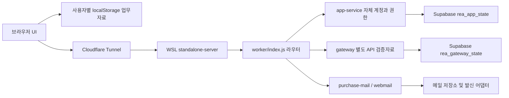
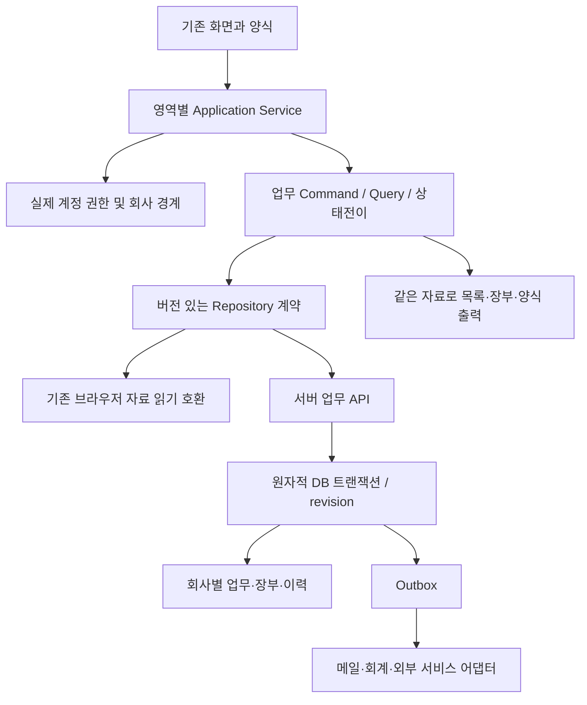

# REA ERP 매뉴얼 동등성 아키텍처

설계판 0.1 · 2026-10-21 · 현재 구현 0.50.0. 아래 **현재**와 **목표**를 구분한다. 설계 작성만으로 스키마·운영 환경·자료를 변경하지 않는다.

## 1. 설계 결정

기존 JavaScript UI와 업무 코어를 유지하고 영역별로 계약을 분리한다. 프레임워크 전면 교체나 새 사이트 제작 없이 기능 차이를 순차 보완한다. 실제 구현 저장소는 /home/lck/projects/Rea_ERP, 수동 운영은 로컬 WSL 서버 + Supabase + Cloudflare Tunnel/rea.qaredi.com이다. 분석 원문은 .artifacts, 요구사항/요약 근거는 docs와 evidence, 실행물은 dist에 분리한다.

## 2. 현재 구조 — 코드 확인

| 현재 책임 | 파일/계약 | 확인한 제약 |
|---|---|---|
| 화면·작업탭·메뉴 | dist/app.js, menu-core.js, inventory-ui.js | 화면별 전용/공통/메뉴만 존재를 구분해야 함 |
| 업무 규칙 | inventory-core.js, entry-core.js, purchase-plan-core.js, purchase-room-core.js | 기존 순수 명령/검증 및 합성자료 검사 재사용 |
| 필드/출력 양식 | form-core.js, form-options.js, entry-ui.js | 기존 필드ID·사용자 설정 유지 필요 |
| 사용자 업무자료 | inventory-ui.js load/commit | 사용자별 localStorage, 전체 JSON 저장. 공용 서버 장부 아님 |
| 인증/정책 | worker/app-service.cjs, dist/self-core.js | 자체 세션 쿠키·CSRF·역할/계정 검증. Supabase Auth로 바꾸지 않음 |
| 서버 상태 | worker/supabase-db.cjs | app/main과 gateway/sandbox 두 행, revision 조건부 PATCH. 범용 SQL API 아님 |
| 메일 | worker/webmail.cjs, purchase-mail.cjs, scripts/mail-rest-store.mjs | 기존 메일 ID/첨부/수신 규칙 보존 |
| 실행/배포 | scripts/standalone-server.cjs, build-worker.cjs | 서버 번들/정적 파일·수동 실행·버전별 검증 |

브라우저 업무자료와 gateway 검증자료는 같은 저장소가 아니다. 현재 계정·메일 운영 성공이 모든 ERP 업무의 공용 저장·동시성·권한 동등성을 입증하지 않는다.

## 3. 목표 구조 — 점진 적용

초기에는 기존 local adapter가 기본이다. 새 서버 저장은 모듈별 전환 지점이 있으며 모든 브라우저 자료를 자동 업로드하거나 빈 서버 상태로 바꾸지 않는다. 공용 업무를 필요로 하는 기능은 실제 서버 adapter와 두 사용자 검증을 통과해야 완료다.

## 4. 영역 경계와 의존성

공통 계정/회사/권한·기초자료·양식 → 구매/재고/영업 → 생산/원가 및 회계 → 세무/급여 → 결재/포털/외부연동 순으로 연결한다. 결재·감사·메일 등의 공통 서비스는 필요한 단계부터 적용한다. 뒤 단계에 필요한 최소 회계/권한 계약은 앞 단계에서 먼저 정의한다.

각 영역은 Command(검증/쓰기), Query(조회), Policy(기본값/기간/권한), Projection(장부/집계), Adapter(저장/외부), View(표시)를 구분한다. 현재 큰 inventory-ui.js에서 기능을 추출할 때 기존 동작 검사를 유지하며 관련 범위만 분리한다. 정책의 우선순위·빈 값·중단 코드 처리는 매뉴얼 근거가 있을 때 확정한다.

## 5. 목표 데이터 계약

다음은 논리 모델이며 아직 운영 테이블을 생성한 것이 아니다.

- Company / User / Role / Permission: 기존 ID·인증 방식 보존, 회사/사업장/창고/역할 범위.
- MasterRecord: 품목·거래처·창고·프로젝트·관리항목·통화·세율 등, 코드/사용상태/유효 시점.
- BusinessDocument / Line: 안정적 문서·행ID, 업무일·작성/수정시각·버전, 원본 연결, 수량/단가/금액, 설정 snapshot.
- DocumentLink / Allocation: 원전표와 결과전표의 행별 소비량·잔량. 복수 원전표/부분 처리에서도 중복 소비를 막음.
- InventoryMovement / LedgerEntry: 입출고/이동/반품 및 회계 영향의 근거, 취소는 매뉴얼의 상태/역처리 계약에 따라 추적.
- FormDefinition: 기존 ID와 필드순서·숨김·필수·기본값·출력 레이아웃·개인/공용 범위·버전.
- ApprovalInstance / Step / Decision: 사용자 신원, 전표 revision, 순차/병렬 규칙, 반려/회수/재상신. 로컬 상태문자만으로 승인 완료 처리 금지.
- Outbox / ExternalResult: 작업 ID, 전표 revision, 재시도 횟수·상태·외부 결과 ID. 타임아웃을 성공으로 만들지 않음.
- AuditEvent / MigrationManifest: 행위자·업무 객체·버전·동작·변환 근거, 비밀값/개인정보 최소화.

금액은 목표 서버 모델에서 정확한 decimal 또는 통화별 최소 단위 정수를 사용한다. 수량 소수 정밀도·세액/공급가 반올림은 문서 정책으로 확정하며 현재 자료를 일괄 재계산하지 않는다. 업무일과 시각(UTC 저장/사용자 표시)을 구분한다.

## 6. 쓰기와 동시성

명령 계약 예: `{commandId, documentId, expectedRevision, payload}`. 회사·사용자·권한은 신뢰된 서버 세션에서 정하며 브라우저 요청값만 믿지 않는다. 변경 전 조회 권한과 변경 권한, 대상 회사, 마감, 원전표 잔량을 서버에서 확인한다.

전표·행별 배분·재고/장부·감사·outbox는 동일 DB 트랜잭션 안에서 확정한다. 기존 REST 두 행의 CAS를 여러 테이블의 트랜잭션이라고 주장하지 않는다. 새 저장소는 검증된 서버 전용 PostgreSQL 호출/RPC 등 원자적 수단을 구현·시험한 뒤 사용한다. 현재 Supabase adapter에 임의 SQL 문자열을 확장하지 않는다.

동일 commandId 재호출은 동일 결과를 반환하고 중복 입고·이동·결재·발송을 막는다. revision 불일치는 409 및 재조회/차이 확인으로 처리한다. 사용자 수정 중 조회/양식 변경이 초안을 날리지 않아야 한다. 취소·재시도·오류 복구는 요구사항별 상태전이 표로 정의한다.

## 7. 기존 자료 전환

1. 현재 로그인 상태와 브라우저 자료, 서버 상태, 양식, 메일, 설정의 비공개 백업·해시·개수·합계·참조를 확보한다.
2. 원본을 쓰지 않는 변환 미리보기로 누락/중복/회사/참조/기간/금액 충돌을 보여준다.
3. 기존 키·ID·양식ID를 보존하거나 매핑표로 추적하며, 시각/세율을 과거 자료에 지어 넣지 않는다.
4. 새 저장 영역에 멱등 import를 수행하고 원본 백업을 그대로 남긴다. 계정이나 서로 다른 사용자의 자료를 무조건 합치지 않는다.
5. 조회 결과·금액·잔량·양식·메일을 비교하고 두 사용자 권한을 검증한다.
6. 기능별 저장 대상을 전환하며 되돌릴 버전·백업·쓰기 중단 지점을 정한다. 실패 시 기존 자료를 자동 삭제하거나 덮어쓰지 않는다.

실제 전환은 릴리스 절차와 해당 사용자 작업 권한 범위 안에서 수행한다. 이 설계판은 전환을 실행하지 않는다.

## 8. 인증·Supabase·외부 연결

자체 계정 세션을 유지한다. secret/service-role 키는 서버의 비공개 설정만 사용하며 브라우저 번들·커뮤니티·로그에 포함하지 않는다. 서버 권한검증이 필수이며 RLS는 추가 방어다. exposed schema의 명시 grant와 RLS를 함께 검토한다. 자체 앱 사용자ID가 자동으로 Supabase auth.uid()가 된다고 가정하지 않는다.

API키·쿠키 인증의 경로별 권한, CSRF/Origin, 입력 크기·첨부 경로·조회 범위를 회귀 검사한다. 권한 변경 후 오래된 세션/전표/발송 요청도 다시 확인한다. 외부 발송/신고/결제는 준비·제출·실제 성공·실패를 구분한다. 외부 시험에는 업무자료 없는 지정 시험을 쓰고 실제 발송 등의 별도 승인이 필요한 시점에 구체적인 대상과 내용을 정한다.

공식 [Data API 보안](https://supabase.com/docs/guides/api/securing-your-api)과 [변경 내역](https://supabase.com/changelog)을 확인했다. 2026-11-10 예정 구형 TLS 암호군 종료가 공지되어 있으므로 이후 배포 연결 검사에 포함한다. 이번 작업은 인증/DB/DNS를 변경하지 않았다.

## 9. REA 원본 구조 분석

REA CLI는 프로젝트에 고정된 6.4.0을 쓴다. 매뉴얼 기능 → 화면/프로그램ID → 공개 자산 URL → SHA-256 → AST 범위/심볼 → 의미 그래프 노드/관계 → 자체 코드 대응 → 테스트를 연결한다. 원본 번들을 실행하지 않는다.

원본과 자체 코드는 입력 디렉터리/manifest를 분리한다. 캐시 키는 입력·설정·도구 버전·결과 해시를 포함하고 evidence schema·실제 파싱 수·실패 수·semantic coverage의 truncated/누락을 확인한다. 큰 번들에서 생략이 있으면 해당 기능의 경계가 보존된 작은 범위로 재분석하고 외부 미해결 관계를 명시한다. 파싱 성공과 runtime dispatch/서버 규칙 확정을 구분한다.

현재 원본은 과거 0.50의 거래유형·관리항목 4개 범위/팝업 wrapper 자료를 근거로 연결한다. 최신 원본 본문 해시의 실보유 여부를 다시 확인하고 누계86개를 곧바로 현재 확보 수로 쓰지 않는다. 오래된 11개 원본 경로를 검사하는 rea:sources 결과는 모두 missing이며 전체 현재 corpus 검사와 다르다.

이번 자체 서버3파일(app-service, gateway, index)은 REA 구문분석3/실패0, 노드7873을 확인했다. 의미 그래프는 truncated=false지만 coverage=unknown, 외부/동적 의미에 partial 관계가 있어 전체 의미 완전성이나 원본 동등성으로 기록하지 않는다.

## 10. 검증과 배포

각 요구사항에 문서/관찰 근거, 순수 코어 검사, 저장·동시성·권한 통합 검사, localhost 합성 브라우저 흐름, 실제 운영 인증/자료보존 검사, 외부/장비 증거를 연결한다. 기존 검사를 버전이 다른 새 요구사항의 합격으로 자동 승격하지 않는다.

배포는 요구사항별 작은 릴리스로 진행한다. 관련 검사 → 전체 verify:local 및 release 검사 → 버전/커밋 → 원격 push → 비공개 백업 → 지정 서버만 수동 반영 → 공개 HTTPS/자산/인증 → 로그인 후 업무 검증 → 자료/양식/메일 보존 → 모아 기록 순서다. 실패 시 성공 기록을 남기지 않는다. 문서만 변경하는 이번 판은 운영 재시작과 앱 버전 증가가 필요 없다.

## 11. 결정 대장

- ADR-01 채택: 기존 앱의 점진 확장, 현재 배포 환경 유지.
- ADR-02 채택: 매뉴얼 시나리오가 완료 단위, 메뉴/REA 후보 수로 완료율 산정 금지.
- ADR-03 채택: local/API/공용 서버 자료의 계약 분리와 보존형 전환.
- ADR-04 설계: 원자적 전표/배분/장부·멱등 outbox, 구현·테스트 후 적용.
- ADR-05 채택: 자체 계정 유지, 실제 사용자 결재는 별도 구현.
- ADR-06 채택: 원본 정적 분석·직접 관찰·자체 정책을 근거로 분리.
- ADR-07 채택: 커뮤니티는 설계/진척의 읽기 가능한 기록, 코드/상태의 근거는 Git과 evidence로 추적.

관련: [PRD](PRD.md), [진행 순서](ROADMAP.md), [조사대장](manual-inventory.md).

## 12. 거래별 부가세 금액 계약 · 2026-10-21 추가

REQ-COM-TAX-001의 첫 단계는 `transaction-vat-core.preview/verify` 순수 계산이다. 입력을 바꾸지 않고 현 lineTotals의 행별 금액을 기준으로 동일세율/KRW 총액을 다시 분리해 마지막행의 차액을 제시한다. 기존 문서의 금액·반올림·양식 기본값은 유지한다. 일시적인 미리보기 근거 검증과 실제 저장 권한/장기 조정 메타를 구분한다.

저장 통합은 inventory-core의 저장·백업·유효금액, 전표 변환/코드변경/단가일괄변경, 반품 배분, 입력/출력/보고서 및 purchase-mail-core PDF 정규화를 한 금액 계약으로 맞춘 뒤 활성화한다. 반환·조정 메타가 있는 자료를 새 계산으로 덮어쓰지 않는다. 외화/혼합세율은 별도 요구사항 검증 전 지원으로 표시하지 않는다. 상세 계약·확인된 위험·검사 순서는 [부가세 계획](../plan-manual-transaction-vat-20261021.md)을 따른다. 이 추가 내용의 모아 게시·재조회는 로그인 복구 후 진행한다.

### 저장 금액 계약 구현 · a593c2e (운영 미반영)

`vatCalculation` 선택 필드가 없는 옛 자료는 기존 라인별 계약이다. 거래별 자료는 `vatAdjustment.version=1`에 금액 기준·원본/행 식별자·차액/합계/마지막행을 저장하고 조회/복원에서 재계산한다. 저장 요청의 `vatConfirmation`은 전체 입력 스냅샷을 대조한 후 제거한다. 기존 DB 근거와 비교하여 메타 누락이 조정 삭제가 되지 않게 하며, 새로 만든 근거만으로 확인 절차를 대신하지 않는다. 확인 데이터는 권한 토큰이 아니며 기존 권한·CAS·반품 잠금이 우선한다.

InventoryCore의 유효금액을 사용자 수식·합계·반품·구매실·메일/PDF에 연결했다. 새 전표는 조정 근거를 상속하지 않으며 코드 변경에서 원본 식별자를 보존한다. 계산 정책 선택/확인/취소/행 음영 UI와 운영 통합이 남아 있다. 서버 재시작 전 이를 완료하고 검증/버전/배포 절차를 따른다. 저장21검사·기존 브라우저30·합성 실제PDF 및 REA4파일 근거는 `evidence/manual-transaction-vat-storage-20261021.json`에 연결했다. 기존 자료/양식/메일을 이관하거나 외부 발송하지 않았다. 모아의 이 추가 본문 게시·재조회는 여전히 대기다.

### 편집기 확인 계약 구현 · 7c5a46c (운영 미반영)

TransactionVatCore.review는 표시 후보와 확인 필요 여부를 순수하게 만든다. 표시 후보를 승인된 저장 요청으로 사용하지 않는다. TransactionVatUI는 확인 직전에 권한·편집 화면·저장본과 전체 입력을 다시 대조한 후에만 vatConfirmation을 붙인다. 취소/Escape/이동은 저장하지 않는다. 기존 조정의 금액 기준이 유지되면 즉시 유효금액과 마지막행 음영을 표시하고, 입력이 달라지면 확정된 표시를 제거해 저장 전 검토를 요구한다. 빈 행을 제외한 금액행과 화면행을 매핑한다.

브라우저 저장은 dbSourceRaw를 읽은 DB와 함께 관리하고 commit/발주계획 생성에서 외부 변경을 감지한다. ‘최신 전표 다시 읽기’는 저장 JSON을 다시 검증해 해당 전표뿐 아니라 다른 자료의 외부 변경을 보존한다. 이는 localStorage 저장 직전 검증이며 동시 쓰기 전체의 원자성/서버 CAS를 보장하지 않는다. 설정 기본값 및 모드 선택은 후속 단계이고 기존 전표 자동 이관은 없다. 근거: evidence/manual-transaction-vat-ui-20261021.json. 이 추가 본문의 모아 게시·재조회는 대기다.
