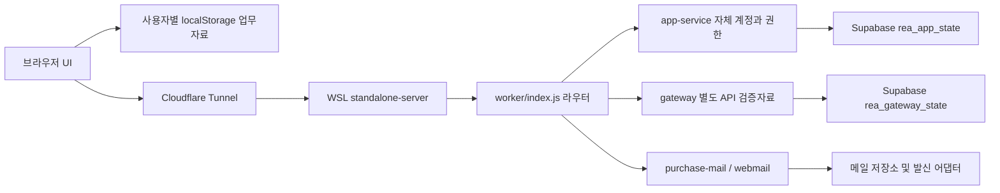
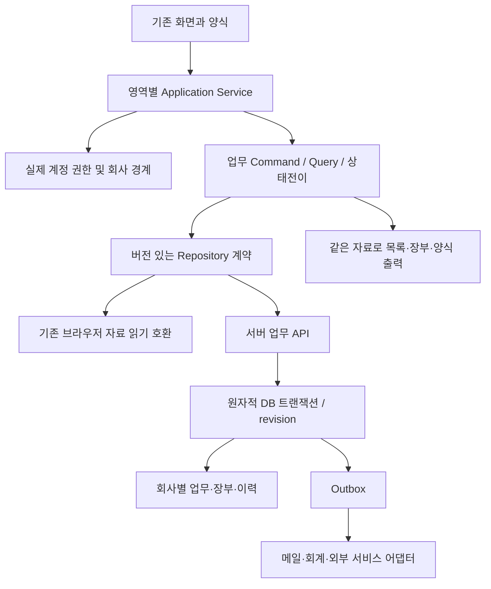
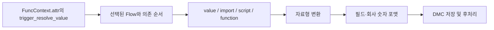

# REA ERP 매뉴얼 동등성 아키텍처

설계판 0.1 · 2026-10-21 · 작성 당시 구현 0.50.0. 아래 **현재**와 **목표**를 구분한다. 설계 작성만으로 스키마·운영 환경·자료를 변경하지 않는다.

## 1. 설계 결정

기존 JavaScript UI와 업무 코어를 유지하고 영역별로 계약을 분리한다. 프레임워크 전면 교체나 새 사이트 제작 없이 기능 차이를 순차 보완한다. 실제 구현 저장소는 /home/lck/projects/Rea_ERP, 수동 운영은 로컬 WSL 서버 + Supabase + Cloudflare Tunnel/rea.qaredi.com이다. 분석 원문은 .artifacts, 요구사항/요약 근거는 docs와 evidence, 실행물은 dist에 분리한다.

## 2. 현재 구조 — 코드 확인

| 현재 책임 | 파일/계약 | 확인한 제약 |
|---|---|---|
| 화면·작업탭·메뉴 | dist/app.js, menu-core.js, inventory-ui.js | 화면별 전용/공통/메뉴만 존재를 구분해야 함 |
| 업무 규칙 | inventory-core.js, entry-core.js, purchase-plan-core.js, purchase-room-core.js | 기존 순수 명령/검증 및 합성자료 검사 재사용 |
| 필드/출력 양식 | form-core.js, form-options.js, entry-ui.js | 기존 필드ID·사용자 설정 유지 필요 |
| 사용자 업무자료 | inventory-ui.js load/commit | 사용자별 localStorage, 전체 JSON 저장. 공용 서버 장부 아님 |
| 인증/정책 | worker/app-service.cjs, dist/self-core.js | 자체 세션 쿠키·CSRF·역할/계정 검증. Supabase Auth로 바꾸지 않음 |
| 서버 상태 | worker/supabase-db.cjs | app/main과 gateway/sandbox 두 행, revision 조건부 PATCH. 범용 SQL API 아님 |
| 메일 | worker/webmail.cjs, purchase-mail.cjs, scripts/mail-rest-store.mjs | 기존 메일 ID/첨부/수신 규칙 보존 |
| 실행/배포 | scripts/standalone-server.cjs, build-worker.cjs | 서버 번들/정적 파일·수동 실행·버전별 검증 |

브라우저 업무자료와 gateway 검증자료는 같은 저장소가 아니다. 현재 계정·메일 운영 성공이 모든 ERP 업무의 공용 저장·동시성·권한 동등성을 입증하지 않는다.

## 3. 목표 구조 — 점진 적용

초기에는 기존 local adapter가 기본이다. 새 서버 저장은 모듈별 전환 지점이 있으며 모든 브라우저 자료를 자동 업로드하거나 빈 서버 상태로 바꾸지 않는다. 공용 업무를 필요로 하는 기능은 실제 서버 adapter와 두 사용자 검증을 통과해야 완료다.

## 4. 영역 경계와 의존성

공통 계정/회사/권한·기초자료·양식 → 구매/재고/영업 → 생산/원가 및 회계 → 세무/급여 → 결재/포털/외부연동 순으로 연결한다. 결재·감사·메일 등의 공통 서비스는 필요한 단계부터 적용한다. 뒤 단계에 필요한 최소 회계/권한 계약은 앞 단계에서 먼저 정의한다.

각 영역은 Command(검증/쓰기), Query(조회), Policy(기본값/기간/권한), Projection(장부/집계), Adapter(저장/외부), View(표시)를 구분한다. 현재 큰 inventory-ui.js에서 기능을 추출할 때 기존 동작 검사를 유지하며 관련 범위만 분리한다. 정책의 우선순위·빈 값·중단 코드 처리는 매뉴얼 근거가 있을 때 확정한다.

## 5. 목표 데이터 계약

다음은 논리 모델이며 아직 운영 테이블을 생성한 것이 아니다.

- Company / User / Role / Permission: 기존 ID·인증 방식 보존, 회사/사업장/창고/역할 범위.
- MasterRecord: 품목·거래처·창고·프로젝트·관리항목·통화·세율 등, 코드/사용상태/유효 시점.
- BusinessDocument / Line: 안정적 문서·행ID, 업무일·작성/수정시각·버전, 원본 연결, 수량/단가/금액, 설정 snapshot.
- DocumentLink / Allocation: 원전표와 결과전표의 행별 소비량·잔량. 복수 원전표/부분 처리에서도 중복 소비를 막음.
- InventoryMovement / LedgerEntry: 입출고/이동/반품 및 회계 영향의 근거, 취소는 매뉴얼의 상태/역처리 계약에 따라 추적.
- FormDefinition: 기존 ID와 필드순서·숨김·필수·기본값·출력 레이아웃·개인/공용 범위·버전.
- ApprovalInstance / Step / Decision: 사용자 신원, 전표 revision, 순차/병렬 규칙, 반려/회수/재상신. 로컬 상태문자만으로 승인 완료 처리 금지.
- Outbox / ExternalResult: 작업 ID, 전표 revision, 재시도 횟수·상태·외부 결과 ID. 타임아웃을 성공으로 만들지 않음.
- AuditEvent / MigrationManifest: 행위자·업무 객체·버전·동작·변환 근거, 비밀값/개인정보 최소화.

금액은 목표 서버 모델에서 정확한 decimal 또는 통화별 최소 단위 정수를 사용한다. 수량 소수 정밀도·세액/공급가 반올림은 문서 정책으로 확정하며 현재 자료를 일괄 재계산하지 않는다. 업무일과 시각(UTC 저장/사용자 표시)을 구분한다.

## 6. 쓰기와 동시성

명령 계약 예: `{commandId, documentId, expectedRevision, payload}`. 회사·사용자·권한은 신뢰된 서버 세션에서 정하며 브라우저 요청값만 믿지 않는다. 변경 전 조회 권한과 변경 권한, 대상 회사, 마감, 원전표 잔량을 서버에서 확인한다.

전표·행별 배분·재고/장부·감사·outbox는 동일 DB 트랜잭션 안에서 확정한다. 기존 REST 두 행의 CAS를 여러 테이블의 트랜잭션이라고 주장하지 않는다. 새 저장소는 검증된 서버 전용 PostgreSQL 호출/RPC 등 원자적 수단을 구현·시험한 뒤 사용한다. 현재 Supabase adapter에 임의 SQL 문자열을 확장하지 않는다.

동일 commandId 재호출은 동일 결과를 반환하고 중복 입고·이동·결재·발송을 막는다. revision 불일치는 409 및 재조회/차이 확인으로 처리한다. 사용자 수정 중 조회/양식 변경이 초안을 날리지 않아야 한다. 취소·재시도·오류 복구는 요구사항별 상태전이 표로 정의한다.

## 7. 기존 자료 전환

1. 현재 로그인 상태와 브라우저 자료, 서버 상태, 양식, 메일, 설정의 비공개 백업·해시·개수·합계·참조를 확보한다.
2. 원본을 쓰지 않는 변환 미리보기로 누락/중복/회사/참조/기간/금액 충돌을 보여준다.
3. 기존 키·ID·양식ID를 보존하거나 매핑표로 추적하며, 시각/세율을 과거 자료에 지어 넣지 않는다.
4. 새 저장 영역에 멱등 import를 수행하고 원본 백업을 그대로 남긴다. 계정이나 서로 다른 사용자의 자료를 무조건 합치지 않는다.
5. 조회 결과·금액·잔량·양식·메일을 비교하고 두 사용자 권한을 검증한다.
6. 기능별 저장 대상을 전환하며 되돌릴 버전·백업·쓰기 중단 지점을 정한다. 실패 시 기존 자료를 자동 삭제하거나 덮어쓰지 않는다.

실제 전환은 릴리스 절차와 해당 사용자 작업 권한 범위 안에서 수행한다. 이 설계판은 전환을 실행하지 않는다.

## 8. 인증·Supabase·외부 연결

자체 계정 세션을 유지한다. secret/service-role 키는 서버의 비공개 설정만 사용하며 브라우저 번들·커뮤니티·로그에 포함하지 않는다. 서버 권한검증이 필수이며 RLS는 추가 방어다. exposed schema의 명시 grant와 RLS를 함께 검토한다. 자체 앱 사용자ID가 자동으로 Supabase auth.uid()가 된다고 가정하지 않는다.

API키·쿠키 인증의 경로별 권한, CSRF/Origin, 입력 크기·첨부 경로·조회 범위를 회귀 검사한다. 권한 변경 후 오래된 세션/전표/발송 요청도 다시 확인한다. 외부 발송/신고/결제는 준비·제출·실제 성공·실패를 구분한다. 외부 시험에는 업무자료 없는 지정 시험을 쓰고 실제 발송 등의 별도 승인이 필요한 시점에 구체적인 대상과 내용을 정한다.

공식 [Data API 보안](https://supabase.com/docs/guides/api/securing-your-api)과 [변경 내역](https://supabase.com/changelog)을 확인했다. 2026-11-10 예정 구형 TLS 암호군 종료가 공지되어 있으므로 이후 배포 연결 검사에 포함한다. 이번 작업은 인증/DB/DNS를 변경하지 않았다.

## 9. REA 원본 구조 분석

REA CLI는 프로젝트에 고정된 6.4.0을 쓴다. 매뉴얼 기능 → 화면/프로그램ID → 공개 자산 URL → SHA-256 → AST 범위/심볼 → 의미 그래프 노드/관계 → 자체 코드 대응 → 테스트를 연결한다. 원본 번들을 실행하지 않는다.

원본과 자체 코드는 입력 디렉터리/manifest를 분리한다. 캐시 키는 입력·설정·도구 버전·결과 해시를 포함하고 evidence schema·실제 파싱 수·실패 수·semantic coverage의 truncated/누락을 확인한다. 큰 번들에서 생략이 있으면 해당 기능의 경계가 보존된 작은 범위로 재분석하고 외부 미해결 관계를 명시한다. 파싱 성공과 runtime dispatch/서버 규칙 확정을 구분한다.

현재 원본은 과거 0.50의 거래유형·관리항목 4개 범위/팝업 wrapper 자료를 근거로 연결한다. 최신 원본 본문 해시의 실보유 여부를 다시 확인하고 누계86개를 곧바로 현재 확보 수로 쓰지 않는다. 오래된 11개 원본 경로를 검사하는 rea:sources 결과는 모두 missing이며 전체 현재 corpus 검사와 다르다.

이번 자체 서버3파일(app-service, gateway, index)은 REA 구문분석3/실패0, 노드7873을 확인했다. 의미 그래프는 truncated=false지만 coverage=unknown, 외부/동적 의미에 partial 관계가 있어 전체 의미 완전성이나 원본 동등성으로 기록하지 않는다.

## 10. 검증과 배포

각 요구사항에 문서/관찰 근거, 순수 코어 검사, 저장·동시성·권한 통합 검사, localhost 합성 브라우저 흐름, 실제 운영 인증/자료보존 검사, 외부/장비 증거를 연결한다. 기존 검사를 버전이 다른 새 요구사항의 합격으로 자동 승격하지 않는다.

배포는 요구사항별 작은 릴리스로 진행한다. 관련 검사 → 전체 verify:local 및 release 검사 → 버전/커밋 → 원격 push → 비공개 백업 → 지정 서버만 수동 반영 → 공개 HTTPS/자산/인증 → 로그인 후 업무 검증 → 자료/양식/메일 보존 → 모아 기록 순서다. 실패 시 성공 기록을 남기지 않는다. 문서만 변경하는 이번 판은 운영 재시작과 앱 버전 증가가 필요 없다.

## 11. 결정 대장

- ADR-01 채택: 기존 앱의 점진 확장, 현재 배포 환경 유지.
- ADR-02 채택: 매뉴얼 시나리오가 완료 단위, 메뉴/REA 후보 수로 완료율 산정 금지.
- ADR-03 채택: local/API/공용 서버 자료의 계약 분리와 보존형 전환.
- ADR-04 설계: 원자적 전표/배분/장부·멱등 outbox, 구현·테스트 후 적용.
- ADR-05 채택: 자체 계정 유지, 실제 사용자 결재는 별도 구현.
- ADR-06 채택: 원본 정적 분석·직접 관찰·자체 정책을 근거로 분리.
- ADR-07 채택: 커뮤니티는 설계/진척의 읽기 가능한 기록, 코드/상태의 근거는 Git과 evidence로 추적.

관련: [PRD](PRD.md), [진행 순서](ROADMAP.md), [조사대장](manual-inventory.md).

## 12. 거래별 부가세 금액 계약 · 2026-10-21 추가

REQ-COM-TAX-001의 첫 단계는 `transaction-vat-core.preview/verify` 순수 계산이다. 입력을 바꾸지 않고 현 lineTotals의 행별 금액을 기준으로 동일세율/KRW 총액을 다시 분리해 마지막행의 차액을 제시한다. 기존 문서의 금액·반올림·양식 기본값은 유지한다. 일시적인 미리보기 근거 검증과 실제 저장 권한/장기 조정 메타를 구분한다.

저장 통합은 inventory-core의 저장·백업·유효금액, 전표 변환/코드변경/단가일괄변경, 반품 배분, 입력/출력/보고서 및 purchase-mail-core PDF 정규화를 한 금액 계약으로 맞춘 뒤 활성화한다. 반환·조정 메타가 있는 자료를 새 계산으로 덮어쓰지 않는다. 외화/혼합세율은 별도 요구사항 검증 전 지원으로 표시하지 않는다. 상세 계약·확인된 위험·검사 순서는 [부가세 계획](../plan-manual-transaction-vat-20261021.md)을 따른다. 이 추가 내용의 모아 게시·재조회는 로그인 복구 후 진행한다.

### 저장 금액 계약 구현 · a593c2e (운영 미반영)

`vatCalculation` 선택 필드가 없는 옛 자료는 기존 라인별 계약이다. 거래별 자료는 `vatAdjustment.version=1`에 금액 기준·원본/행 식별자·차액/합계/마지막행을 저장하고 조회/복원에서 재계산한다. 저장 요청의 `vatConfirmation`은 전체 입력 스냅샷을 대조한 후 제거한다. 기존 DB 근거와 비교하여 메타 누락이 조정 삭제가 되지 않게 하며, 새로 만든 근거만으로 확인 절차를 대신하지 않는다. 확인 데이터는 권한 토큰이 아니며 기존 권한·CAS·반품 잠금이 우선한다.

InventoryCore의 유효금액을 사용자 수식·합계·반품·구매실·메일/PDF에 연결했다. 새 전표는 조정 근거를 상속하지 않으며 코드 변경에서 원본 식별자를 보존한다. 계산 정책 선택/확인/취소/행 음영 UI와 운영 통합이 남아 있다. 서버 재시작 전 이를 완료하고 검증/버전/배포 절차를 따른다. 저장21검사·기존 브라우저30·합성 실제PDF 및 REA4파일 근거는 `evidence/manual-transaction-vat-storage-20261021.json`에 연결했다. 기존 자료/양식/메일을 이관하거나 외부 발송하지 않았다. 모아의 이 추가 본문 게시·재조회는 여전히 대기다.

### 편집기 확인 계약 구현 · 7c5a46c (운영 미반영)

TransactionVatCore.review는 표시 후보와 확인 필요 여부를 순수하게 만든다. 표시 후보를 승인된 저장 요청으로 사용하지 않는다. TransactionVatUI는 확인 직전에 권한·편집 화면·저장본과 전체 입력을 다시 대조한 후에만 vatConfirmation을 붙인다. 취소/Escape/이동은 저장하지 않는다. 기존 조정의 금액 기준이 유지되면 즉시 유효금액과 마지막행 음영을 표시하고, 입력이 달라지면 확정된 표시를 제거해 저장 전 검토를 요구한다. 빈 행을 제외한 금액행과 화면행을 매핑한다.

브라우저 저장은 dbSourceRaw를 읽은 DB와 함께 관리하고 commit/발주계획 생성에서 외부 변경을 감지한다. ‘최신 전표 다시 읽기’는 저장 JSON을 다시 검증해 해당 전표뿐 아니라 다른 자료의 외부 변경을 보존한다. 이는 localStorage 저장 직전 검증이며 동시 쓰기 전체의 원자성/서버 CAS를 보장하지 않는다. 설정 기본값 및 모드 선택은 후속 단계이고 기존 전표 자동 이관은 없다. 근거: evidence/manual-transaction-vat-ui-20261021.json. 이 추가 본문의 모아 게시·재조회는 대기다.

### 선택적 계산모드 설정 계약 · 94a569e (운영 미반영)

회사 설정의 documentVat 규칙은 네 구매 유형별 default/line/transaction을 저장한다. 원본 bizz 속성 vat_calculate_setup의 line/transaction·기본line이라는 정적 근거를 자체 스키마에 대응했으며 동적 예외조건은 포함하지 않는다. 기존 config.write/CSRF/revision CAS 경로로 저장하고 publicContext와 SelfUI 재조회에서 AuthUI에 전달한다. 옛 상태를 읽을 때 새 키를 영속화하지 않는다.

새 빈 입력을 최초 생성할 때만 모드를 스냅샷으로 적용한다. 기존 전표·보관 초안·현재 편집·임시 변환은 자동 재적용하지 않는다. 설정 선택 UI 및 계획생성/변환 적용 계약은 남았다. 원본 정적 SetVatReCalcSvc에 맞춰 실제 변경된 공급/세액 셀만 #f6d7d7·굵게 표시한다. 설정 통합24검사/VAT61/브라우저33 및 원본7·자체7 REA 근거는 evidence/manual-transaction-vat-settings-20261021.json이다. 모아 갱신·재조회와 운영 반영은 대기다.

## 계산 근거 충돌과 버전 보존 · 2026-10-21

거래별 VAT의 공식 본문은 총액을 다시 분리하고 보관 공개 번들의 계산 함수는 미반올림 공급가액 합에서 공급·세액을 각각 단수처리한다. 공통 예제는 일치하나 별도5경계값에서 충돌한다. 진단 도구와 합성 fixture는 앱 dist/worker 밖에 두며 원본 JS를 실행하지 않는다. 진단 종료0과 원본 동등성 합격은 분리되고 --require-parity는 미해결 상태에서2를 반환한다. 원본 소수 자릿수는 공급/세액 공통이므로 자체 분리된 정책과 동등하다고 추정하지 않는다.

현재 vatAdjustment.version1은 기존 총액 분리식으로 읽고 검증하는 계약이다. 새 계산식을 도입하더라도 기존 금액·백업·반품 근거를 새 식으로 재해석하거나 자동 이관하지 않는다. 신규 버전별 계산/검증/출력과 명시적 전환 계약을 먼저 확정한다. 원본의 직접 공급가액·외화·혼합세율·Decimal 호환 정밀도는 별도의 입력/정책/저장 근거가 필요하다. 근거와 후속 순서는 docs/plan-manual-transaction-vat-20261021.md 및 evidence/manual-transaction-vat-conflicts-20261021.json을 따른다.

## 연결 헤더 및 저장 계산 버전 보존 · 2026-10-21

소스6f1a017의 원본 수정 보호는 active direct sourceId 후속의 기존 유효한 거래처/창고 조건을 새로 깨뜨릴 때만 거절한다. linkedPartner/linkedWarehouse와 자식 저장의 창고 대상 목록을 공유한다. 상태 변경은 비활성→활성으로 바뀐 전표에 한해 최종 배치의 원본을 검사하므로 부모/자식 선택 순서가 결과를 바꾸지 않는다. 명령은 복사 DB에서 실행되어 실패 시 자료·이력·재고·채무를 반환하지 않는다. 기존 활성 불일치 백업을 자동 수정하거나 새 검증으로 소급 거절하지 않는다. 이는 독립 저장 무결성 보완이며 원본 수정 정책 전체와 동일하다는 의미가 아니다.

VAT v1은 고정 합성 백업과 고정 메일 결과로 금액 계약을 검증한다. 미래 식 변경 시 버전별 해석을 분리해야 하며 테스트에서 현재 계산기로 fixture를 다시 만들어 기대값을 덮어쓰지 않는다. 미지원 버전은 기존처럼 거절하고 v2/마이그레이션은 미구현이다. 근거: evidence/manual-purchase-link-preservation-20261021.json. 운영0.53.0 유지, 이 추가 본문 모아 게시·재조회 대기.

### 독립 수식 후보와 저장 버전 경계 · 4e52469

scripts/lib/transaction-vat-static-candidate.cjs는 저장v2가 아닌 연구 알고리즘 raw-supply-static-candidate-v0다. source-like 공급합과 명시적 현재 행금액을 입력으로 받아 정적 목표/차액을 산출하고 항상 canApply=false를 반환한다. 임의의 총액 보존/음수 보정/기존 금액 재생성 없이 차이를 드러낸다. UI/Worker에서 import하지 않으며 기존 vatAdjustment.version1의 읽기·수정·백업·반품·메일 해석은 그대로다.

향후 저장v2는 (1)공식 본문과 실제 적용 원본의 충돌 해소 (2)지원모드·정밀도·반올림·0/음수·직접금액 계약 확정 (3)버전별 별도 검증기·금액소비 경로 (4)명시확인과 후속반품/회계 제약 (5)옛 백업/구버전클라이언트 보존을 통과한 뒤 추가한다. candidate 결과를 version2 메타로 바꾸거나 v1식에 자동 치환하지 않는다. 현재5충돌/동등성false를 유지한다. 근거 evidence/manual-vat-static-candidate-20261021.json; 이 본문의 모아 저장/재조회 대기.

### 단가 생성과 계산 후보의 정밀도 경계 · 8c07d91

단가검색은 원본 Price/PriceVatInclude를 각각 apply_price_amt/vat_apply_price_amt로 매핑해 포맷처리한 뒤 값resolver를 호출한다. F4는 공급단가 변환 뒤 필드 포맷을 적용한다. 동적 필드 식·라이브 설정·실제Decimal이 확인되기 전 최종 공급가액 생성 전체를 재현했다고 하지 않는다. common 모듈의 R/10은 포맷 없는 apply_price_amt에 한정된 fallback이며 origin_supply_amt는 숨김열 회사포맷 fallback에서 제외된다.

연구 후보 raw-supply-static-candidate-v1은 이미 결정된 단가의10자리만 정확히 받도록 확장했다. 수량6/금액0~2/단일0·10% 범위는 유지한다. 이는 저장 vatAdjustment.version1 또는 계획된 저장v2와 관계없는 연구 알고리즘 식별자다. 앱 import·기존 금액 재계산·양식기본값 변경은 없고 canApply=false다. 근거 evidence/manual-vat-price-binding-20261021.json.

### 단계별 원본 행 식별자 계약 · 2026-10-21

sourceLineId는 언제나 현재 전표의 sourceId가 가리키는 즉시 원본의 lineId에 대응한다. 원본 자체가 상위 전표에 연결되어 있다는 이유로 그 상위 sourceLineId를 다음 단계에 전달하지 않는다. 즉시 원본에 lineId가 없으면 기존 품목별 연결/잔량을 사용한다. 기존 백업의 부모 식별자는 보존하고, 모호한 중복 품목은 기존 저장 검증으로 거절한다. 새 ID 자동 이관·양식/출처/금액 변경은 없다. 근거 evidence/manual-purchase-source-lineage-20261021.json.

### 묶음 발주 배분의 완료행 보호 · 59b2c4f

saveDoc의 generatedFrom=purchase-plan 경로는 배분 구조/출처를 검증한 뒤 (원본전표, 품목, 원본행 ID 또는 없음)별 전체 수량을 합산한다. 완료 원본행의 새 배분 합계가 해당 전표의 이전 저장 합계보다 크면 거부한다. 이전 전표의 활성 여부와 무관하게 저장 수량을 기준으로 하므로 동량 취소·복원은 보존된다. 행 진행 상태를 헤더보다 우선하는 기존 규칙과 백업 검증 정책은 변경하지 않는다. 분할·재정렬·동량 가격 수정은 허용하고 기존 자료를 이관하거나 과거 완료 기록을 소급 거절하지 않는다. 원본 ECOUNT의 완료/복원 정책 전체가 검증됐다는 의미는 아니다. 근거 evidence/manual-plan-allocation-preservation-20261021.json.

### 입력 자동변경과 숫자 후처리의 근거 경계 · 420cfd5

원본의 기본 입력 경로와 조회/인쇄 경로는 속성 출처와 extension이 다르다. 입력 경로의 정적 구조는 아래와 같다. 명시적 override와 직접 공급가액 custom sync 예외는 별도다.

현재 wrapper는 이 경로를 보여 주지만 실제 선택된 식·참조/trigger·후처리 포맷·Decimal 구현까지 입증하지 않는다. 조회/인쇄의 value_calc_expression을 입력 수식으로 대체하거나 7개 정적 기대값 일치를 전체 원본 합격으로 처리하지 않는다. 기존 저장v1·연구후보 raw-supply-static-candidate-v1은 변경하지 않는다. 근거 evidence/manual-vat-resolver-20261021.json; 모아 본문 반영·재조회 대기.

### 발주수량 보유재고 차감 연구 모델 · efca279

stock-only-integer-v0는 앱 계산/저장 계약과 분리된 scripts/lib 순수 함수다. 명시적 정수 입력·보유재고만 받아0하한 차감을 계산하며 실제 재고를 조회하지 않는다. 행 ID와 품목/창고 튜플을 각각 검증하여 같은 보유재고를 여러 계획행에서 중복 차감하는 추정 배분을 막는다. 결과는 항상 canApply=false이며 기존 전표나 양식에 저장하지 않는다. 최소구매단위·혼합조건·소수/음수·조회기준·후속발주 하한은 추가 근거 후 별도 계약으로 연결한다. 공식 사례5개의 일치는 전체 수량조정 동등성의 증거가 아니다. 근거 evidence/manual-plan-quantity-stock-candidate-20261021.json.

## 0.53.1 운영 경계 확인 · 2026-10-21

분리후보90958ac를 기존 WSL 수동 서버/Supabase/Cloudflare에 설치했다. 스키마·인증방식·기존 자료구조는 그대로다. 원본 헤더/행공급사·직접 행참조·완료계획 배분 보호를 포함하고 미완료 VAT는 main에 남긴다. 기존120분 세션이 이미 만료되어 배포 후 인증UI 합격은 재로그인 뒤 별도로 확인한다. 공개 응답·서버 자료/메일 보존과 매뉴얼 동등성은 구분한다. 상세 evidence/deployment-purchase-links-0531-20261021.json.

### Decimal 초기 정밀도와 운영 계산의 분리 · 18393fe

decimal29-divisor-order-v0는 순수 연구 함수이며 공급합/세율/단수처리만 명시 입력받는다. BigInt 유리수로100÷세율→공급합÷그값을 각29유효자리 HALF_UP하고 최종 자릿수를 처리한다. 계산 가능한 범위를 좁혀 두고 항상canApply=false/persistenceVersion=null을 반환한다. 기존 저장v1·단가 연구후보와 앱의 import/저장 연결은 변경하지 않는다. 새로운 원본 Decimal 초기 설정과 실제 실행 중 override·입력식·누적/차액배분은 별도 증거다.

현재 확인한 common 본문의 valid-key trigger는 빈행 skip 예외를 포함한다. 이전 resolver 본문과 현재 본문 해시·함수 차이를 같이 보관하고 버전 간 동등성을 추정하지 않는다. REA21범위 파싱과 독립13,302사례 일치는 실제 매뉴얼/테넌트 전표 결과의 합격이 아니다. 운영0.53.1 설치번들 보존, 상세 evidence/manual-vat-decimal-20261021.json.

### 명시적 확정세율의 그룹 배분 연구 · d8035b9

previewResolvedGroups는 각 행에 이미 결정된 numeric vatRate(검토범위0/10)를 요구한다. 실제 거래유형/품목/창고 설정을 조회하거나 추정하지 않는다. first-seen 그룹과 원래 인덱스를 보관하고 기존 단일 연구후보 결과를 원래 순서로 재배치하며 각 그룹 마지막행만 보정 대상으로 표시한다. 전역ID 유일성·전체행수·미반올림공급/현재합계/목표합계 상한을 적용해 그룹 단위 검증 우회를 막는다. 그룹별 차액이 서로 상쇄돼도 확인 필요가 유지된다.

계산/저장권한·UI 반영·부가세설정 상속은 추가하지 않았고 canApply=false/persistenceVersion=null이다. 원본의 빈행 제외/loose 세율 비교/중복ID 위치처리까지 재현했다고 주장하지 않으며 연구입력에서는 거부한다. 기존v1와 단일 후보를 보존하고 후속 증거와 저장 버전 계약 전에는 앱에 통합하지 않는다. evidence/manual-vat-groups-20261021.json.

### 발주계획 생성 선택수와 기존 전표 저장 한도의 분리 · b5d2ff8

PurchasePlanCore.MAX_SELECTIONS=100은 preview의 선택 원본행 수에 적용한다. 동일품목 합산 전 검증하며 commit이 preview를 다시 수행해 준비 결과의 선택수 변경도 거절한다. 목록 조기 검증과 미리보기 오류는 선택 상태를 유지한다. source candidateRows의 전체 목록·기존 전표/백업 검증·일반 저장 명령에100행 한도를 소급 적용하지 않는다. 수량조정의 별도500상세 제한과도 다른 계약이다. 원본 정적 handler의 checked 항목수 계약을 현재 자체 품목행 목록에 맞췄으며 원본 전표별 목록의 모든 모드/권한/저장 결과까지 입증하지는 않는다.

분리후보0.53.2는 운영0.53.1 + 이 변경과 버전 표시만 포함하고 미완료VAT는 제외한다. 설치 전후 자료보존 게이트가 남아 있으며 현재 운영번들은 변경하지 않았다. evidence/manual-plan-generation-limit-20261021.json.

### 구매의 실제 입고창고와 원본 잔량 분리 · b1f2292

linkedWarehouseMatches는 purchaseorder→purchase 한 edge에서만 별도 입고창고를 허용한다. stageDocuments와 convert/save, 원본 헤더 변경·취소 복원 검사에 공유하며 기본 linkedWarehouse는 그대로여서 원본창고 검색·표시·명시 머리항목 적용은 유지된다. sourceId/sourceLineId별 잔량은 창고와 독립적으로 모든 구매에 합산하고 재고 이동은 실제 구매.warehouse에서 발생한다. 반품/교환·다른 edge는 기존 창고계약을 유지한다.

validateReceiptWarehouseChange는 저장 직전에 이전/새 창고를 비교한다. 기존 purchase/exchangereceipt에 같은 documentId의 inspections/racks가 있으면 변경을 거절한다. 재고만 옮겨 기존 실물 기록과 분리되는 오류를 방지하며 백업 전체 검사에 새 제약을 추가하지 않는다. 기존 불일치 자료의 읽기·동일창고 저장과 검수 지문에 따른 재검수 동작은 유지한다. 원본 제품의 검수 제한을 확인했다는 주장은 아니며 자체 기존 실물 기록을 보존하는 가드다.

분리후보0.53.2 9e4efd1는100선택 제한과 이번 변경을 포함한다. 이전 a71301a는 과거 후보이며 최신 번들/검사는 .artifacts/purchase-receiving-warehouse-20261021/candidate-manifest.json에 고정한다. main 미완료 VAT와 운영0.53.1을 분리하며 evidence/manual-purchase-receiving-warehouse-20261021.json를 따른다. 최종 매뉴얼 합격은 인증 후 절차·권한·결과·보존·운영 검증 후에만 판정한다.

### 단가요청 불러오기와 향후 공급사 회신 저장의 분리 · cb8baa0

이번 변경은 pricerequest 전용 주 도구줄에서 주문/계획의 기존 EntryUI.openDocuments 복사 모드를 호출한다. sourceId/수량 할당 연결을 새로 만들지 않으며 importedFrom은 기존 복사 출처를 보존한다. sourceType=plan은 바로가기 필터이고 apply는 편집 초안, 명시 저장만 document 명령을 실행한다. 웹자료올리기는 보조 details에 남기고 전용 entry-price-request-secondary 표시 규칙으로 모바일에서 숨지 않게 한다. 다른 구매 화면 CSS는 바꾸지 않는다.

현재 pricerequest의 단일 partner와 db.prices 특별단가 레지스트리는 그대로다. 후속 복수 공급사 회신은 별도 계약으로 설계한다. 원본 품목행의 안정된 lineId, 요청가/수취가/확정가 구분, 1~5거래처, 유효기간·입력마감, 명시 확정 선택과 발주서 출처/감사기록, 기존 백업 호환과 권한을 검증해야 한다. db.prices를 회신 저장소로 쓰거나 pricerequest를 구매유형 배열에 일괄 추가해 세액·상태·이력 계약을 넓히지 않는다. 영상에 없는 외부 회신 인증·만료·재발급을 추정하지 않는다.

0.53.2 최신 후보72b523d의 검증/번들은 .artifacts/manual-price-request-20261021/candidate-manifest.json, 운영은0.53.1이다. 전체 단가요청 비교/메일/인증 저장 결과 동등성은 미완료다. evidence/manual-price-request-import-20261021.json.

### 단가요청 비교 부속 상태 v1의 독립 모델 · 8002335

현재 scripts/lib/price-request-comparison.cjs는 Node 전용이며 기존 전표에 자동 부착하지 않는다. 상태는 format/version/revision/source/vendors/selections다. source에는 원본 전체의 정렬된 JSON 지문과 행 목록을 고정한다. 행키는 기존 lineId의 공백까지 보존한 id: 값, ID 없는 옛 행은 row:위치이며 전체 지문으로 행 이동/내용 변화를 감지한다. vendors는1~5개 고유 코드와 inputClosed/행별 received, selections는 품목행마다 요청가 또는 특정거래처 회신가의 명시적 선택이다. null은 미회신, 문자열0은 회신0원이다. 요청가/회신가/확정가는 덮어쓰지 않는다.

command는 expectedRevision과 현재 원본을 검증한 뒤 새 상태를 반환한다. 마감 시 회신수정 거절, 재개방 시 기존 값 보존, 선택된 회신 변경 전 명시적 선택해제를 적용한다. 이들은 자체 보존규칙이며 원본 마감/취소의 전체 의미로 주장하지 않는다. 모든 저장 배열은 빠짐없이 소유한 인덱스를 갖도록 검사한다. 가격은 범위 내 소수10자리, 수량은 양수 소수6자리의 십진문자열로 한정하고 조용한 반올림을 하지 않는다. 지원범위 밖 옛 전표는 변경하지 않은 채 새 비교 시작만 거절한다.

지문은 인증 서명이 아니다. 다음 통합에서는 브라우저 호환 동일 지문 계산, 서버의 역할/원자적 수정번호 검사, source 삭제/변경/취소 시 부속상태 보존·명시 재설정, backup의 버전/역참조 검증과 구버전 읽기, 안정된 행ID 및 회사 경계를 먼저 확정한다. 기존 db.prices나 document.partner를 회신 배열로 재해석하지 않는다. 외부 회신 URL/권한/만료와 발주서의 확정가 공급사/잔량 배분은 별도 계약이다.

근거 evidence/manual-price-request-comparison-model-20261021.json. 운영과 preparedCandidate는 변경하지 않는다.

### 비교 부속 저장과 역사적 원본 보존 · 3eff892

PriceRequestCore는 dist의 UMD 공유모듈이다. v2의 source.fingerprint는 정렬된 원본 JSON 자체이며 이전 연구 v1 SHA256과 구별한다. 현재 store는 version1/records이고 record는 documentId/snapshot/comparison이다. 최초 snapshot과 회신을 원본 저장·취소·코드 변경으로 다시 쓰지 않는다. validateStore는 snapshot과 comparison의 정합성만 검사해 원본이 없거나 달라진 과거자료도 백업할 수 있다. view는 원본없음/비활성/변경/거래처사용불가를 구분하고 ready일 때만 수정한다. 새로운 거래처·새 원본에 과거 확정단가를 자동 재결합하지 않는다. 재기준화·초기화/삭제는 아직 제공하지 않는다.

InventoryCore.command/validateBackup는 optional store를 JSON clone 전에 먼저 검증한다. NaN/Infinity/undefined가 null이나 필드누락으로 바뀌기 전에 거절하며 priceRequest payload도 원형 검증을 거친다. 정상명령은 clone DB에서 수정번호 검사와 store 갱신/로그만 수행한다. 일반 settings로 store를 주입·초기화하지 못한다. 기존 legacy DB에는 store를 자동 추가하지 않는다. 기록의 원본코드는 현재 master에 맞춰 고쳐 쓰지 않으며 quoted vendor가 없어지거나 비활성화되면 읽기만 허용한다.

브라우저 HTML·합성 preview와 worker bundler는 같은 모듈을 로드한다. 저장계층의 공유코어와 백업 bridge 합성 검증을 마쳤지만 comparison UI 및 전용 server mutation API는 아직 없다. 코어 expectedRevision은 앱 전체 서버 CAS/역할권한을 대신하지 않는다. 브라우저 저장소와 서버 업무 영역은 계속 별개이며 자동 동기화하지 않는다. main 전체 검증번들은 미완료 VAT를 포함하므로 운영 설치물이 아니다. 근거 evidence/manual-price-request-storage-20261021.json.

### 읽기 전용 단가 비교와 권한/수명 경계 · b7101ad

PriceRequestUI.open은 canRead/getDb/documentId만 받아 저장 callback을 갖지 않는다. InventoryUI는 현재 사용자별 storageKey와 inventory.read, storageError, dbSourceRaw를 검증한 뒤 현재 브라우저 DB를 제공한다. 저장 자료가 없으면 기존 pricerequest의 요청가만 계산하며 Q.create/storeCommand를 호출하지 않는다. 보관 자료는 Q.view의 snapshot/행/상태를 사용한다. 숫자 표시도 십진문자열로 처리하고 거래처/품목명은 textContent로 넣는다. 현재 master의 표시명과 과거코드는 구별하며 이름의 역사적 스냅샷을 새로 추정하지 않는다.

새로고침·window focus/storage에서 권한과 저장소를 다시 검사한다. 검사 실패 시 이전 표를 제거한다. dialog.close는 native close와 별개로 동기식 idempotent finish를 수행하므로 지연된 close 이벤트가 새 창을 지우거나 포커스를 빼앗지 않는다. beforeNavigate와 편집창 정리에 포함한다. 이는 기존 브라우저 자료 영역의 읽기 보호이며 서버 역할/CAS나 외부 공급사 인증을 대체하지 않는다.

행 작업 영역 진입과 새로고침/닫기/스크롤 안내는 현재 앱 통합 방식이며 원본의 정확한 메뉴/버튼 배치 동등성으로 주장하지 않는다. supplier picker·직접회신·마감/확정 저장·외부메일·발주서 적용은 별도 검증을 남긴다. evidence/manual-price-request-view-20261021.json.

읽기 UI의 운영 분리 후보는0.53.2 08b4b9d이다. 기존72b523d에서 priceRequest 저장/백업과 비교UI만 추가했고 VAT는 제외했다. 후보에는 기존 raw 기준 감지 함수가 없어 load와 각 기존 저장·교체 경로의 기준값 추적을 별도로 추가했다. 비교 조회에서만 원문 일치를 검사하며 일반 저장의 기존 동작은 바꾸지 않았다. 후보전체verify/브라우저39 및 독립3경로 확인 완료, 설치false. 정확한 입력/번들은 .artifacts/manual-price-view-20261021/candidate-manifest.json을 따른다.

### 확정단가 편집과 원자 저장 · ad5a1dd

이전 읽기 전용 UI를 선택적으로 확장한다. PriceRequestUI는 canRead/getDb 외에 canWrite/onSave를 선택적으로 받으며 없으면 기존 조회 전용이다. ready store만 편집할 수 있고 기존 selection을 draft Map으로 복사한다. 자동 기본선택·최저가 선택은 하지 않는다. 변경한 행만 {lineKey,source,vendorCode} 배열로 제출하며 가격은 클라이언트 입력값을 신뢰하지 않고 core가 현재 요청/회신에서 읽는다. selectMany는 dense1~500행/중복/미회신/수정번호를 검사하고 clone에서 모두 처리한 뒤 한 revision으로 저장한다. 저장소 version1과 model version2는 그대로다.

Adapter는 실제 사용자별 storageKey, inventory.read/write, raw 기준을 저장 직전 재확인한다. focus는 draft를 유지하며 자료 지문/revision/권한을 확인한다. 권한 복구와 실제 자료 충돌을 구별하고 자료가 여전히 동일할 때만 저장을 다시 허용한다. 저장 실패는 draft를 유지하며 read 권한 상실은 내용을 지운다. 새로고침/닫기/Escape는 저장하지 않는다. 기존 문서·prices·customization·회신은 변하지 않는다. 이는 로컬 자료 영역이며 서버 quote API/회사 역할/CAS/외부회신 인증을 대체하지 않는다.

최신 분리 후보 f181c53, manifest .artifacts/manual-price-selection-20261021/candidate-manifest.json. 기존 후보의 raw 추적을 유지하고 새 선택 저장에서만 명시 assertStorageCurrent를 추가했다. 부가세 미완성 코드는 포함하지 않는다. 실제 원본 라디오 기본값/헤더 일괄선택/미선택 저장 규칙은 미확인이므로 전체 재현 완료가 아니다.

## 2026-10-21 구현 추가 · 거래처별 입력마감/취소

0.53.4의 PriceRequestUI는 ready 비교상태·쓰기권한이 있을 때만 거래처 열에 입력마감/취소 버튼을 표시한다. 동일한 inventory-ui onSave 어댑터는 selectMany 또는 close만 허용하며 사용자/권한·원문 baseline을 검증하고 기존 PriceRequestCore close 명령으로 단일 commit한다. 확정선택 초안 중에는 마감 버튼을 숨기고 이미 제거된 버튼 이벤트를 차단한다. 오류 시 기존 표/선택/자료를 보존한다.

서버 API·비교스키마·공용장부/외부 공급사 인증을 추가하지 않았다. 합성 저장/재조회와 운영 설치/로그인/보존을 구분한다. 운영 비교자료0건이므로 실제 마감 저장 합격은 대기다. 다음 연결은 원본 근거를 확보한 공급사 시작/직접회신 UI이며 기존 저장·권한 경계를 재사용한다. 근거 evidence/manual-price-request-input-close-20261021.json.

## 2026-10-21 구현 추가 · 수취단가 직접입력

0.53.5의 PriceRequestUI는 거래처별 가격 편집 초안을 비교표와 분리하고 replyMany 명령으로 변경행만 단일 commit한다. core는 모든 행과 마감/확정선택/수정번호를 검증한 뒤 사본에 반영하고 검증 실패 시 예외를 발생시키고 원본은 변경하지 않는다. 기존 UI 어댑터의 사용자·권한·raw baseline 검사와 공유 core를 재사용한다. 데이터 버전·Worker 인증/메일 코드는 그대로이며 bundle에 변경 PriceRequestCore가 포함된다.

수량/헤더/세금 편집, 공급사 등록/비교 시작 UI, 외부 공급사 인증/회신 및 발주 적용은 이번 범위 밖이다. 자체 마감·확정선택 보호를 원본 직원 예외 정책으로 간주하지 않는다. 합성42브라우저 및 운영 보존을 구분하고 실제 업무 저장/전역 매뉴얼 합격은 미완료다. 근거 evidence/manual-price-request-direct-reply-20261021.json.

## 2026-10-21 구현 추가 · 신규 단가요청 공급사 연결

0.53.6은 신규 전표에만 ReferencePickerUI의1~5개 공급사 선택 초안을 연결한다. priceRequestCreate는 기존 saveDoc과 PriceRequestCore start를 하나의 사본에서 실행하며, 전표·공급사 검증 전체 성공 후 한 번 저장한다. 저장 스키마 변경이나 기존자료 이관은 없다. 비교가 있는 전표의 공급사는 읽기전용으로 표시하고 기존 회신을 재시작하지 않는다. 조회·필터·CSV는 companion의 공급사 목록을 참조한다. API/외부 공급사 인증/유효기간 만료/발주서 적용은 별도 합격 항목이다. 근거 evidence/manual-price-request-suppliers-20261021.json.

### 0.53.7 최초 확정 초안 기본값

PriceRequestUI가 ready 비교자료에서 기존 확정값이 하나도 없을 때만 요청단가를 초안 Map에 초기화한다. 이미 부분 확정된 자료는 기존 선택/미선택을 복원한다. 이 값은 persisted comparison과 분리되며 기존 selectMany의 단일 명령과 onSave 어댑터가 명시 저장 시 권한/계정/raw/source/revision을 검사한다. 모델·저장스키마·서버인증·메일·VAT를 변경하지 않는다. 원본 헤더 전체선택/부분규칙/발주서 적용·외부회신의 동등성은 별도 미완료다.
